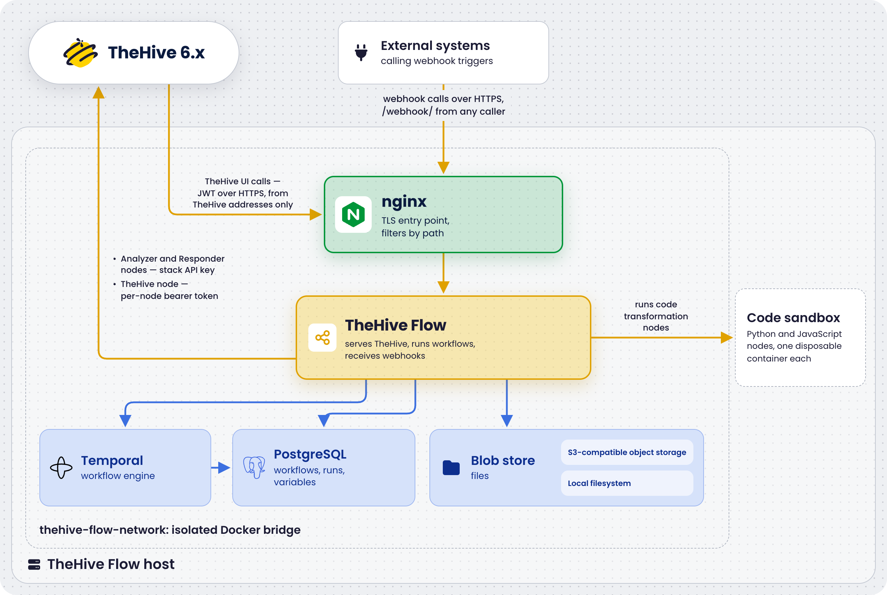
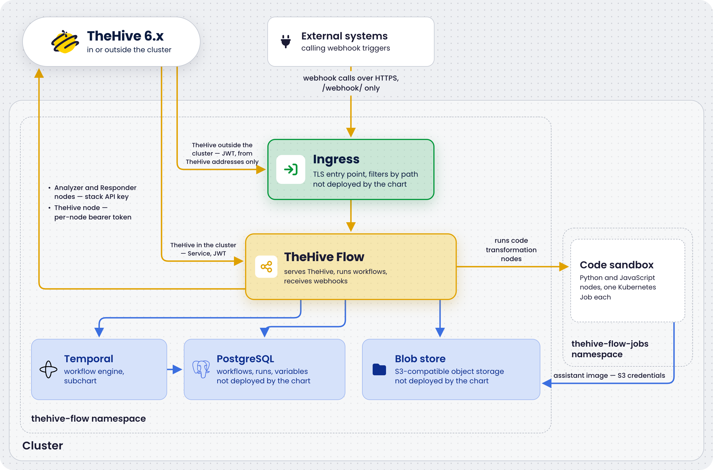

# TheHive Flow System Requirements

<!-- md:version 6.0 --> <!-- md:license One -->

[TheHive Flow](../user-guides/about-flow.md) hardware and storage requirements depend on the deployment method: a [Docker Compose stack](docker.md) on a single Linux host, separate from the host running TheHive, or a [Helm chart on a Kubernetes cluster](kubernetes.md).





## Hardware requirements

=== "Docker Compose deployment"

    The stack deploys the following services on the host:

    { width=70% .center }

    ### Deployment profiles

    Two deployment profiles are available in the [StrangeBee Docker Compose repository](https://github.com/StrangeBeeCorp/docker/tree/main){target=_blank}. Both deploy the same services and differ in the resources allocated to each one.

    | Profile | Usage | Recommended memory | Recommended CPU | Disk |
    | ------- | ----- | ------------------ | --------------- | ---- |
    | [*Production environment #1*](https://github.com/StrangeBeeCorp/docker/tree/main/prod1-thehive-flow){target=_blank}, `prod1-thehive-flow` | Standard production workload | 8 GB RAM | 4 vCPUs | 50 GB |
    | [*Production environment #2*](https://github.com/StrangeBeeCorp/docker/tree/main/prod2-thehive-flow){target=_blank}, `prod2-thehive-flow` | High-performance or resource-intensive workload | 16 GB RAM | 8 vCPUs | 100 GB |

    These figures are what the stack itself needs. They come on top of the operating system and any other services running on the same host. The disk figures are a starting point: see [Data storage](#data-storage) for what drives the growth.

    ### Memory limits per service

    The `docker-compose.yml` file of each profile defines a memory limit and a CPU limit for each service, under `deploy.resources.limits`. The file also sets `memswap_limit` to the same value as the memory limit, so that a container can't swap instead of being stopped. These are hard limits enforced by the Docker runtime. The out-of-memory (OOM) killer terminates a container that exceeds its memory limit.

    | Service | Profile #1 | Profile #2 | Notes |
    | ------- | ---------- | ---------- | ----- |
    | `postgresql` | 1 GB, 2 CPUs | 4 GB, 4 CPUs | Hosts three databases: `thehive_flow`, `temporal`, and `temporal_visibility`. Profile #2 also sets `shared_buffers` to 1 GB and `effective_cache_size` to 3 GB |
    | `temporal` | 1 GB, 2 CPUs | 2 GB, 4 CPUs | Workflow engine |
    | `thehive-flow` | 1 GB, 2 CPUs | 2 GB, 4 CPUs | Stateless server with low RAM usage. The limit is a safety cap. Also carries `GOMEMLIMIT`, described in the next section |
    | `s3-store` | 512 MB, 1 CPU | 1 GB, 2 CPUs | SeaweedFS S3-compatible object storage holding the blobs |
    | `nginx` | 512 MB, 1 CPU | 1 GB, 1 CPU | Reverse proxy that typically uses under 50 MB |
    | `temporal-admin` | 256 MB | 256 MB | Only active during admin operations such as schema migrations and namespace creation |
    | `init-s3-store` | 256 MB | 256 MB | One-shot container that provisions the S3 bucket at startup, then exits |
    | **Stack total** | **~4 GB** | **~10 GB** | **On top of the operating system and any other services on the host** |

    Adjust limits in `docker-compose.yml` based on observed usage with `docker stats`, then apply them with `docker compose up -d`. Keep `memswap_limit` equal to the memory limit.

    ### Go memory limit of the `thehive-flow` service

    The `thehive-flow` container carries a second ceiling: the `GOMEMLIMIT` environment variable, set in `docker-compose.yml` to 85% of the memory limit of the service. That's `870MiB` for the 1 GB limit of profile #1 and `1740MiB` for the 2 GB limit of profile #2. The Go garbage collector doesn't read the container limit on its own. Without `GOMEMLIMIT`, it would let the heap grow until the OOM killer terminates the container. Because a single process both handles incoming requests and runs the workflows, that kill restarts the whole application rather than a single step.

    When raising the `thehive-flow` memory limit, raise the memory limit, `memswap_limit`, and `GOMEMLIMIT` together, keeping at least 128 MiB between `GOMEMLIMIT` and the memory limit. Only Go binary suffixes are valid, such as `870MiB`. With a malformed value such as `870MB`, the container exits immediately.

    ### Code transformation containers

    TheHive Flow runs [Python and JavaScript code transformations](../user-guides/configure-transformation-node.md) in disposable containers launched on the host Docker daemon, outside the stack and its memory limits. Three properties matter for host sizing:

    * No resource limits: The containers run without a memory or CPU cap, so a memory-hungry script competes with the stack and the operating system for host RAM.
    * No fixed concurrency ceiling: One container runs per executing transformation step, so the count follows how many runs execute transformations at the same time.
    * Short-lived: Each container is removed as soon as its script exits.

    A small `ryuk` reaper container also runs on the host daemon for the life of the `thehive-flow` service, and removes orphaned script containers after a crash.

    The recommended profile sizing above covers typical transformation workloads. For workflows running many concurrent transformations, or scripts processing large inputs in memory, budget extra RAM on top of the stack total. The [transformation language images](software-requirements.md#images-pulled-at-first-start) add approximately 80 MB to the Docker image cache.

=== "Kubernetes deployment with Helm"

    The chart and its deployment scenarios deploy the following on the cluster:

    { width=70% .center }

    ### Chart sizing defaults

    The chart and the deployment scenarios ship the following defaults. Every pod of the chart gets a CPU request but no CPU limit, so pods can burst into spare CPU. The [data storage](#data-storage) growth drivers apply unchanged. Plan for approximately 1 MB per workflow run in the `thehive_flow` database, and two to five times that for the Temporal history, depending on retention. The blob store size follows the run retention, as described in [Blob store volume sizing](#blob-store-volume-sizing).

    | Component | Default | Tuning |
    | --------- | ------- | ------ |
    | TheHive Flow pod | Requests 250m CPU and 512 MiB of memory, limited to 1 GiB of memory | The `resources.*` values. The Go memory limit is derived as 85% of the memory limit through `goMemLimitPercent`, so raising `resources.limits.memory` raises it too. The chart refuses to render when the derived margin falls under 128 MiB |
    | Database migrations job | Requests 100m CPU and 128 MiB of memory, limited to 256 MiB of memory | The `migrations.resources.*` values |
    | PostgreSQL cluster | One instance and 10 GiB of storage on the default storage class, with no resource requests or limits | The `scenarios/cnpg/postgres-cluster.yaml` manifest: set `instances: 3` for high availability, set `storageClass`, add resources, and grow the storage for production, following the [PostgreSQL volume sizing baseline](#postgresql-volume-sizing) |
    | Temporal | Five pods, one per service, requesting 550m CPU and 1.3 GiB of memory in total, limited to 2.75 GiB of memory in total. See [Temporal services](#temporal-services) for the per-service values. History shards: 512, immutable for the cluster's life | The `temporal.server.<service>.resources` and `temporal.admintools.resources` values. `temporal.server.config.persistence.numHistoryShards` sets the shard count: [change it before the first installation or not at all](kubernetes.md#step-6-install-the-chart) |
    | Object storage | One SeaweedFS pod with a 10 GiB persistent volume claim on the default storage class, with the resource defaults of the SeaweedFS chart | The `scenarios/seaweedfs/seaweedfs-values.yaml` file: `allInOne.data.size` for the volume, `allInOne.resources` for the pod. For more than one replica, use the distributed mode of the SeaweedFS chart instead of `allInOne` |
    | Code transformation jobs | No CPU or memory constraints, a 2 GiB cap on the working directory, and a 24-hour cap on a job's run time | `codex.kubernetes.resources` for requests and limits, `codex.kubernetes.ephemeralStorage` to change the cap on the working directory, `codex.kubernetes.activeDeadlineSeconds` to shorten the cap on a job's run time, and `codex.maxConcurrentActivityExecutionSize` to cap how many jobs one language runs at once |

    #### Temporal services

    The bundled Temporal runs as five pods. History gets the largest share because it caches workflow histories across the 512 history shards, so under load it's the first service to need more memory. The admin-tools pod only runs operational commands and is mostly idle. Keep these defaults unless the OOM killer terminates a Temporal pod.

    | Service | Role | CPU request | Memory request | Memory limit | Values key |
    | ------- | ---- | ----------- | -------------- | ------------ | ---------- |
    | Frontend | gRPC entry point for TheHive Flow | 100m | 256 MiB | 512 MiB | `temporal.server.frontend.resources` |
    | History | Workflow state and event histories | 200m | 512 MiB | 1 GiB | `temporal.server.history.resources` |
    | Matching | Task queues dispatching work to the worker of TheHive Flow | 100m | 256 MiB | 512 MiB | `temporal.server.matching.resources` |
    | Worker | Internal Temporal system workflows | 100m | 256 MiB | 512 MiB | `temporal.server.worker.resources` |
    | Admin tools | Operations CLI | 50m | 64 MiB | 256 MiB | `temporal.admintools.resources` |

## Data storage

The following table lists the locations where the Docker Compose stack stores data and what drives their growth. The two data directories live in the profile directory, so the filesystem holding the repository clone is the one to size and watch. The Docker image cache and the daemon log files live under `/var/lib/docker`, and the backup root wherever `backup.sh` is pointed at.

| Location | Content | Growth driver |
| -------- | ------- | ------------- |
| `./postgresql/data` | All PostgreSQL data: the `thehive_flow` database, Temporal history, and Temporal visibility index | Number of workflow runs and history retention period |
| `./s3-store/data` | Blob store contents: files ingested through [webhooks](../user-guides/add-trigger.md#add-a-webhook-trigger) or runs, and activity outputs promoted out of the database | Volume and size of the files the workflows handle, and the run retention period. See [Blob store volume sizing](#blob-store-volume-sizing) |
| Docker image cache | [Pinned images for all services](software-requirements.md#images-pulled-at-first-start) | Static after the initial pull, approximately 1 GB total. Grows with each upgrade until `docker image prune` runs |
| Backup root, `/opt/backups/thehive-flow` in the examples | [Backup folders](../operations/backup-restore.md) produced by `backup.sh`: a full copy of the two data directories above, the configuration, and `.env` | Operator retention policy multiplied by the size of the data directories |
| Docker daemon log files | Container stdout and stderr in JSON format | [Log rotation configuration](../operations/logging.md#configure-docker-log-rotation) |

### PostgreSQL volume sizing

Use the following planning baseline:

* Plan for approximately 1 MB per workflow run in the `thehive_flow` database. This covers definitions, run state, variables, and the run and step execution history.
* Temporal history is typically two to five times the size of the `thehive_flow` database, depending on workflow complexity and the configured retention period.

For example, 10,000 workflow runs per month over 12 months, at a 3 MB average, results in approximately 360 MB for the `thehive_flow` database and approximately 1 GB for Temporal. Adjust for the actual workload.

To check the actual directory and database sizes, see [Monitor TheHive Flow](../operations/monitoring.md#check-service-status).

### Blob store volume sizing

Both [blob store back ends](../configuration/flow-configuration.md#blob-store) follow the same sizing rules. The blobs live in the `./s3-store/data` directory with the default `s3` back end, and in the configured blob directory with the `local` back end.

The blob store holds whole files, so its growth follows what the workflows carry rather than how many times they run. Content is deduplicated within an organization: two runs in the same organization handling the same file store it once, because blobs are addressed by organization and SHA-256 hash. The same file handled by two different organizations is stored twice, by design. The organization boundary is a tenancy boundary, not a caching one.

Files follow the [run retention](../configuration/flow-configuration.md#run-retention), 30 days by default. The purge runs at every startup of TheHive Flow, then periodically. When it deletes a run, the files the run references are queued, and a deletion job removes them shortly after the startup purge and at regular intervals afterward. A file is deleted only when no run of the same organization still references it and nobody has stored the same content in the last 24 hours. Files that no run references are never deleted, such as an upload whose request failed after the file was stored. With `modules.runs.retention: 0`, nothing is purged, so no file is deleted.

Watch the size of the directory and add a host-level disk alert, as described in [Monitor TheHive Flow](../operations/monitoring.md#disk-alerting-for-the-blob-store). If it approaches the disk budget, provision more disk or shorten `modules.runs.retention`. Read [Temporal workflow history retention](../operations/maintenance.md#temporal-workflow-history-retention) first: shortening the retention deletes history.

The `s3-store` container is capped at 512 MB of RAM in profile #1 and 1 GB in profile #2, regardless of how much data it stores. The store keeps an on-disk index rather than an in-memory catalog, so memory tracks concurrent request volume, not object count. The single-node profile of the stack has one client, TheHive Flow, so the cap is sized for that. If the OOM killer terminates the container, see [Troubleshoot TheHive Flow](../operations/troubleshooting.md#disk-and-resources).

## Recommended operating systems

The Docker Compose host is officially supported on the following distributions:

* Debian 12
* Ubuntu 22.04
* RHEL 9

<h2>Next steps</h2>

* [TheHive Flow Software Requirements](software-requirements.md)
* [Deploy TheHive Flow with Docker Compose](docker.md)
* [Deploy TheHive Flow on Kubernetes](kubernetes.md)
* [Monitor TheHive Flow](../operations/monitoring.md)
