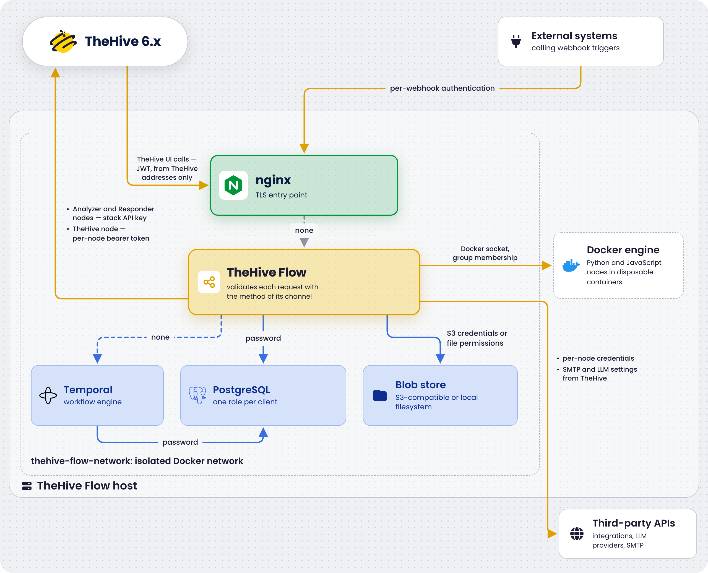

# Authentication Between TheHive Flow Components

<!-- md:version 6.0 --> <!-- md:license One -->

Every channel between [TheHive Flow](../user-guides/about-flow.md), TheHive, and the services of the stack carries its own authentication mechanism.



The following diagram shows each channel and its mechanism. Blue arrows mark the services TheHive Flow needs to start: Temporal, PostgreSQL, and the blob store. The yellow arrows are used at run time only, when users work in the **Flow** view or when workflows run. Dashed arrows carry no authentication and rely on the isolation of the `thehive-flow-network` Docker network.

{ width=70% .center }

## Authentication matrix

| Channel | Mechanism | Direction | Where configured |
| ------- | --------- | --------- | ---------------- |
| TheHive → TheHive Flow | JWT HS256, symmetric | TheHive signs, TheHive Flow validates | [`jwt_signing_key`](../configuration/environment-variables.md) in the `.env` file of TheHive Flow, and [`TH_FLOW_KEY` or `flow.jwt_signing_key`](../installation/docker.md#step-10-configure-thehive-to-reach-thehive-flow) in TheHive |
| External system → *Webhook* trigger | Per-webhook method: none by default, Basic Auth, header key, or JWT | The caller authenticates each request, unless the method is *None* | The [authentication section of the *Webhook* trigger](../user-guides/add-trigger.md#add-a-webhook-trigger) |
| TheHive Flow → TheHive, *Analyzer* and *Responder* nodes | API key, bearer token | TheHive Flow signs each request | `thehive-flow/secret/thehive-api-key`, or `thehive_api_key` in `.env` |
| TheHive Flow → TheHive, *TheHive* node | Bearer token set in the node, usually a secret global variable | TheHive Flow signs each request | The **Authentication** section of the [*TheHive* integration node](../user-guides/configure-integration-node.md#configure-a-thehive-integration-node) |
| TheHive Flow → PostgreSQL | Username and password | Connects as the `thehive_flow` role | `flow_db_password` in `.env`, expanded into the connection string of [`thehive-flow/config/thehive-flow.yml`](../configuration/flow-configuration.md) |
| Temporal → PostgreSQL | Username and password | Connects as the `temporal` role | `temporal_db_password` in `.env`, rendered into `temporal/config/temporal-server.yaml` by `init.sh` |
| TheHive Flow → Blob store | S3 access key and secret with the `s3` back end. Filesystem ownership and permissions with the `local` back end | TheHive Flow signs each S3 request, or writes as the container user | [`s3_access_key_id` and `s3_secret_access_key`](../configuration/environment-variables.md#s3-credentials) in `.env`, or the [`blobstore.local.path`](../configuration/flow-configuration.md#local-filesystem-back-end) directory |
| TheHive Flow → Docker engine | Membership of the group owning the Unix socket | TheHive Flow starts and removes the code transformation containers | The socket mount and the `docker_gid` group of the `thehive-flow` service in `docker-compose.yml`. See [Docker engine access](../configuration/environment-variables.md#docker-engine-access) |
| TheHive Flow → Third-party APIs | Per-node method, such as an API key, a bearer token, or Basic Auth | TheHive Flow authenticates each request | The **Authentication** section of each [integration node](../user-guides/configure-integration-node.md), or the **Authentication** option of each [*HTTP request* node](../user-guides/configure-action-node.md#configure-an-http-request-action-node) |
| TheHive Flow → LLM provider | API key of the provider, when it requires one | TheHive Flow authenticates each request of an [*AI* node](../user-guides/configure-action-node.md#configure-an-ai-action-node) | The [LLM providers configured in TheHive](../../thehive/administration/manage-llm-providers.md), which TheHive pushes to TheHive Flow |
| TheHive Flow → SMTP server | SMTP username and password, when the server requires them | TheHive Flow authenticates the session of each [*Send email* node](../user-guides/configure-action-node.md#configure-a-send-email-action-node) | The [SMTP configuration in TheHive](../../thehive/administration/smtp/configure-smtp-server.md), which TheHive pushes to TheHive Flow, or the [email server override](../configuration/flow-configuration.md#email-server-override) in `thehive-flow/config/thehive-flow.yml` |
| TheHive Flow → Temporal | None | Trust through network isolation | The [`thehive-flow-network` Docker bridge](security.md#network-isolation) |
| Nginx → TheHive Flow | None | Trust through network isolation | The [`thehive-flow-network` Docker bridge](security.md#network-isolation) |

## JWT between TheHive and TheHive Flow

Both services use the same algorithm: HS256, an HMAC-SHA256 signature with a symmetric key.

* The `init.sh` script generates the key with `openssl rand -hex 32` and stores it in `.env` as `jwt_signing_key`.
* The `thehive-flow` service receives it through the `BEEFLOW_SECRET_JWT_SYMMETRIC_KEY` environment variable set in `docker-compose.yml`.
* TheHive must be [configured with the same value](../installation/docker.md#step-10-configure-thehive-to-reach-thehive-flow): through the `TH_FLOW_KEY` environment variable, or through `flow.jwt_signing_key` in the mounted `application.conf` when TheHive runs with `--no-config`.

There's no automated key exchange or rotation protocol. The key is set once at install time and [rotated manually](security.md#jwt-signing-key). A key you set yourself must be at least 32 characters long.

Tokens expire 1 minute after signing, with a 30-second validation leeway in TheHive Flow. Keep the clocks of both hosts synchronized with NTP: a larger clock skew makes TheHive Flow reject every token as expired.

!!! warning "Common pitfall: Docker Compose environment variable syntax"
    With the list syntax, quotes become part of the value and cause a `token signature is invalid` error:

    ```yaml
    environment:
      - TH_FLOW_KEY="<jwt_signing_key>"
    ```

    Use the mapping syntax instead, where YAML strips the quotes:

    ```yaml
    environment:
      TH_FLOW_KEY: "<jwt_signing_key>"
    ```

    The list syntax also works without quotes:

    ```yaml
    environment:
      - TH_FLOW_KEY=<jwt_signing_key>
    ```

## Direct calls to TheHive Flow

Calling the `/api/` paths of TheHive Flow directly, without going through TheHive, isn't a supported integration. The shipped nginx only forwards TheHive requests from the addresses listed in [`nginx_thehive_addresses`](../configuration/environment-variables.md) in `.env`: a request from any other address receives a `403` before reaching TheHive Flow. To start workflows from your own systems, use [*Webhook* triggers](../user-guides/add-trigger.md#add-a-webhook-trigger) instead: they enter through nginx on port 443 and carry their own authentication method, independent of the JWT.

## TheHive API key

TheHive Flow uses a bearer token to authenticate the requests that *Analyzer* and *Responder* nodes send to TheHive. TheHive Flow reads the token from the `BEEFLOW_SECRET_THEHIVE_API_KEY` environment variable, filled from `thehive_api_key` in `.env`, and falls back to the `thehive-api-key` file inside the configured `secret_path` when the variable is empty: `/secret` in the container, mapped from `./thehive-flow/secret/` on the host.

The *TheHive* integration node doesn't use this token. It authenticates with the bearer token set in its own **Authentication** section, usually stored in a [secret global variable](../user-guides/manage-global-variables.md).

The file contains the raw token, and stays readable by its owner only, like the other secret files of the stack:

```bash
printf '%s' '<thehive_api_key>' > ./thehive-flow/secret/thehive-api-key
chmod 600 ./thehive-flow/secret/thehive-api-key
```

See the [secrets inventory](security.md#secrets-inventory).

!!! note "Whitespace is trimmed from every secret"
    The loader trims leading and trailing whitespace and newlines from all secrets it resolves, whether from a file or a `BEEFLOW_SECRET_*` environment variable. This includes the JWT signing key, TheHive API key, and any Docker registry credentials such as passwords and identity or registry tokens. A trailing newline in a secret file is therefore harmless, and a secret value that must contain leading or trailing whitespace isn't supported.

## PostgreSQL authentication

The `init.sh` script creates the `thehive_flow` and `temporal` database roles when they're missing, with the passwords of [`.env`](../configuration/environment-variables.md), and aligns the roles with those passwords at each later run. The passwords are stored in `.env` and in `temporal/config/temporal-server.yaml`, both readable by their owner only and covered by `.gitignore`. They're never embedded in tracked configuration files.

## Key rotation

See [Rotate secrets](security.md#rotate-secrets) for the procedure of each key.

<h2>Next steps</h2>

* [TheHive Flow Security](security.md)
* [Deploy TheHive Flow with Docker Compose](../installation/docker.md)
* [Troubleshoot TheHive Flow](troubleshooting.md)
