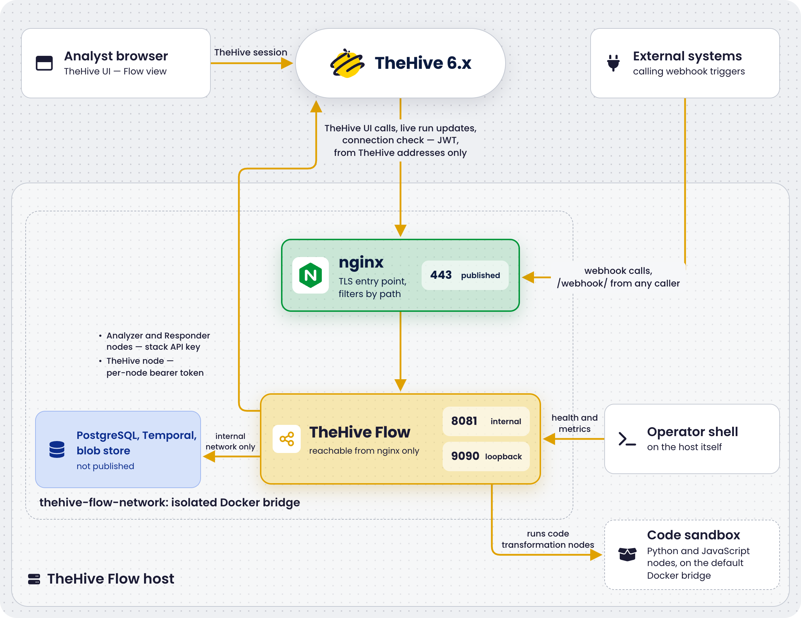

# TheHive Flow Security

<!-- md:version 6.0 --> <!-- md:license One -->

[TheHive Flow](../user-guides/about-flow.md) generates and stores several secrets on its host, isolates its services on an internal Docker network, and terminates TLS at the nginx entry point.



## Secrets inventory

| Secret | Location on host | Generated by |
| ------ | ---------------- | ------------ |
| PostgreSQL superuser password | `.env` | `init.sh` |
| `thehive_flow` database password | `.env` | `init.sh` |
| `temporal` database password | `.env`, and its copy in `temporal/config/temporal-server.yaml` | `init.sh` |
| JWT signing key | `.env` | `init.sh` |
| S3 secret access key | `.env`, and its copy in the identity the object storage keeps in `s3-store/data` | `init.sh` |
| TheHive API key | `thehive-flow/secret/thehive-api-key`, or `.env` | Operator |
| SMTP password of an [email server override](../configuration/flow-configuration.md#email-server-override), when one is defined | The file of `thehive-flow/secret/` named in its `password` key | Operator |
| TLS private key | `nginx/certs/server.key` | `init.sh` or operator |
| Secret variables and settings pushed by TheHive | The `thehive_flow` database, in `postgresql/data` | TheHive and the users |
| Copies of all the above | The backup folders of [`backup.sh`](backup-restore.md) | `backup.sh` |

All generated secrets are 256-bit random values produced by `openssl rand -hex 32`. None are committed to git: `.env`, `thehive-flow/secret/*`, the rendered Temporal configuration, the certificate files, and the data directories are all covered by `.gitignore`.

The `postgresql`, `temporal`, `s3-store`, and `thehive-flow` services run as the user who ran `init.sh`, so the secret files can stay readable by their owner only. Nginx runs as root inside its container and reads the TLS certificate files regardless of their mode. The script sets `.env`, `temporal/config/temporal-server.yaml`, and the TLS private key `nginx/certs/server.key` to mode 600. The `check_permissions.sh` script, which `init.sh` runs first, expects the files of `thehive-flow/secret/` and the private keys of `nginx/certs/` and `certificates/` at mode 600 too. The `backup.sh` script creates each backup folder at mode 700.

### Organization secret variables

Organization [secret variables](../user-guides/manage-global-variables.md) live in the PostgreSQL database, not on the host filesystem. Their values are never displayed in the interface, and execution logs don't record them among the resolved inputs of a node. A workflow can't reference a secret in a value that's stored or returned, such as a run label, a workflow output, or the value of a [*Set local variable* node](../user-guides/configure-transformation-node.md#configure-a-set-local-variable-node). Code nodes are the exception: they receive secrets in clear and can print them, as described in [Code transformation isolation](#code-transformation-isolation). Their only copy outside the database is the database backup, covered in the warning below.

### Settings pushed by TheHive

TheHive pushes its license token and three of its own settings to TheHive Flow, which stores the settings in the PostgreSQL database and uses them to open the connections itself:

* The [SMTP configuration](../../thehive/administration/smtp/configure-smtp-server.md), including the SMTP password, used by [*Send email* nodes](../user-guides/configure-action-node.md#configure-a-send-email-action-node).
* The [LLM providers](../../thehive/administration/manage-llm-providers.md), including their API keys, used by [*AI* nodes](../user-guides/configure-action-node.md#configure-an-ai-action-node).
* The [outbound proxy settings](../../thehive/configuration/proxy-settings.md), including the proxy password.

The database stores these values unencrypted. Anyone who can read the database or its backup can read them, so restrict access to the PostgreSQL service and protect the backups as described in the warning below. Change these settings in TheHive, not in TheHive Flow. The only exception is SMTP: an [email server override](../configuration/flow-configuration.md#email-server-override) defined in `thehive-flow/config/thehive-flow.yml` replaces the SMTP configuration pushed by TheHive. Its password lives in a file of `thehive-flow/secret/` or in the `BEEFLOW_SECRET_MAILER_PASSWORD` environment variable, not in the database.

### External secret managers

Secrets don't have to stay in `.env`. Docker Compose reads a variable from the shell that runs it before falling back to `.env`, so an external secret manager can export `jwt_signing_key`, `thehive_api_key`, `s3_secret_access_key`, `flow_db_password`, `temporal_db_password`, and `postgres_password` at deploy time. Inside the container, TheHive Flow resolves every `BEEFLOW_SECRET_*` variable from its environment first and falls back to the file in `/secret`. A variable set to an empty value counts as unset, and the file fallback engages.

Two limits apply. The `init.sh` script writes every secret it generates into `.env` regardless, so the file has to be protected either way. And the Temporal database password always lands on disk: `temporal/config/temporal-server.yaml` holds it, rendered by `init.sh`.

The Docker registry credentials of [custom code transformation images](../configuration/flow-configuration.md#code-transformation-images) and the password of an [email server override](../configuration/flow-configuration.md#email-server-override) aren't declared in `.env` or in `docker-compose.yml`. Pass them through the `environment:` block of the `thehive-flow` service, as described in [Environment variable overrides](../configuration/flow-configuration.md#environment-variable-overrides).

!!! warning "Backup folders carry secrets"
    The object storage keeps its own S3 identity in cleartext inside `s3-store/data`, both the access key and the secret key. The database holds the organization [secret variables](../user-guides/manage-global-variables.md) and the [settings pushed by TheHive](#settings-pushed-by-thehive), with the SMTP password, the LLM provider API keys, and the proxy password. And every backup holds `.env`, the API key file, and the TLS private key. The `backup.sh` script therefore creates its folders at mode 700. Treat the backup location with the same care as `.env`: [encrypt the backups before shipping them off-host](backup-restore.md#optional-step-3-ship-the-backups-off-host), and don't relax the permissions to make them easier to copy.

## Network isolation

Users never reach TheHive Flow directly. The browser talks to TheHive, which forwards the calls of the **Flow** view to TheHive Flow with a JWT and streams the live execution updates back to the browser. TheHive Flow calls TheHive back with an API key to run Cortex analyzers and responders. Webhook callers are the only other traffic that reaches the host, and all of it enters through nginx on port 443.

{ width=70% .center }

* `thehive-flow-network` is an isolated Docker bridge. No port is reachable from the host unless explicitly declared with `ports:`.
* The `thehive-flow` service on port 8081 isn't published on the host: all traffic enters through nginx on port 443.
* Nginx forwards TheHive requests only from the addresses listed in [`nginx_thehive_addresses`](../configuration/environment-variables.md) in `.env`, set by `init.sh`. A request from any other address receives `403`, and so does every request while the list is empty. Webhook calls stay open to any caller. See [TheHive address filtering](#thehive-address-filtering).
* The [observability listener](monitoring.md#health-endpoints) on port 9090 is published on loopback only, `127.0.0.1:9090`, so operators can reach `/livez` and `/readyz` from the host. It has no application-level authentication: protect it with host firewall rules if the `/metrics` data is sensitive.
* PostgreSQL, Temporal, and the object storage aren't published on the host at all. The S3 API on port 8333 is reachable only from inside `thehive-flow-network`.
* Outbound connections opened by workflow nodes go through an egress guard that blocks non-public addresses, so a workflow can't probe the internal network. Internal targets must be explicitly allowlisted: see [Egress allowlist](../configuration/flow-configuration.md#egress-allowlist). Code transformation nodes are the exception: see [Code transformation isolation](#code-transformation-isolation).

### TheHive address filtering

TheHive is the only client of the `/api/` paths, and it enforces the security of these routes: a call that reaches them without going through TheHive bypasses it. Nginx therefore forwards `/api/` only from the addresses in `nginx_thehive_addresses`, and answers `404` to every path other than `/api/` and `/webhook/`.

List every node of a TheHive cluster. When TheHive goes through an outbound proxy or a Network Address Translation (NAT) device, nginx sees the address of that device. Listing it opens TheHive requests to every other client of that device too.

At start, nginx logs each entry it allows, and each entry it skips with the reason: an entry that isn't an IPv4 address or range, or an entry that covers the Docker network gateway. The filter relies on nginx seeing the real address of the caller. With the default Docker port publishing on Linux, it does. `docker-proxy` relays the connection instead for a client connecting over IPv6, with rootless Docker, or with `"iptables": false` in the Docker daemon configuration. In these cases, nginx sees the gateway of `thehive-flow-network`, the `.1` address of the network, for every such caller. Allowing that address would open TheHive requests to all of them, so nginx skips any entry that covers it. If the nginx log shows the gateway as the `client:` of refused TheHive requests, make TheHive reach the host over a path that keeps its address, such as IPv4, instead of changing the list.

## Code transformation isolation

On Kubernetes, see [Code transformation isolation on Kubernetes](../installation/kubernetes.md#code-transformation-isolation).

[*Python code* and *JavaScript code* nodes](../user-guides/configure-transformation-node.md#configure-a-python-code-node) run the script a workflow author wrote. Every user holding the `manageOrchestrator/writeWorkflows` permission can therefore run arbitrary code on the deployment, and the script runs with the same trust as that user. Grant the permission accordingly.

Each script runs in a disposable container on the host Docker daemon, launched from a [distroless image](../configuration/flow-configuration.md#code-transformation-images) for the run and removed as soon as the script exits or its node timeout expires. A small `ryuk` reaper container also runs on the host daemon for the life of the `thehive-flow` service, and removes orphaned script containers after a crash. To launch these containers, the `thehive-flow` service mounts the Docker socket of the host, which grants it root-equivalent access to the host, as mounting the socket in Cortex does for analyzers. Inside the script container, the deployment doesn't restrict the script further:

* Network: The container joins the default Docker bridge, not `thehive-flow-network`. The script can reach the internet and every address the host can reach, including services on the local network. The egress guard doesn't apply to it, and the [egress allowlist](../configuration/flow-configuration.md#egress-allowlist) has no effect on it. The stack's internal services stay out of reach by name, since they only live on `thehive-flow-network`.
* User: The script runs as the user of the image, which is root for the two default images, with the default Docker capability set.
* Resources: No CPU, memory, or process limit is set on the container. A runaway script competes with the rest of the host until the node timeout stops it.
* Secrets: A [secret variable](../user-guides/manage-global-variables.md) the script references is handed to it in clear, and nothing prevents the script from printing it. Printed values land in the `script_out` output and in the execution logs, which don't redact them.

To reduce the exposure:

* Restrict the `manageOrchestrator/writeWorkflows` permission to the profiles that need it, and review the code nodes of [imported workflows](../user-guides/import-export-workflows.md) before running them.
* Filter the outbound traffic of the default bridge with host firewall rules, for example in the `DOCKER-USER` chain, to keep scripts away from the internal network.
* Build a [custom execution image](../configuration/flow-configuration.md#code-transformation-images) that runs as a non-root user when the scripts don't need root.
* Keep the node timeout short, since it's the only bound on a script's run time.

## Webhook exposure

[*Webhook* triggers](../user-guides/add-trigger.md#add-a-webhook-trigger) are the one entry point designed to be called by external systems. They don't go through TheHive. They enter through nginx on port 443, under the `/webhook/` path prefix of the [public URL](../configuration/environment-variables.md#public-url). The authentication method configured on each webhook controls who can start the workflow, so select one for any webhook reachable from outside your network.

Two network-level restrictions narrow the exposure further:

* Host firewall: When every caller is known, restrict inbound port 443 to their source addresses. TheHive reaches TheHive Flow on the same port, so keep TheHive host among the allowed sources.
* Nginx: To restrict only the webhook paths while TheHive requests stay restricted to [`nginx_thehive_addresses`](../configuration/environment-variables.md), add access rules to the existing `location /webhook/` block of the [nginx configuration template](../configuration/nginx-configuration.md), above its `proxy_pass` line. Then restart nginx with `docker compose restart nginx`. The server-level proxy directives are inherited, so the block only needs the access rules and `proxy_pass`:

    ```nginx
    location /webhook/ {
        allow <caller_cidr>;
        deny  all;
        proxy_pass http://thehive-flow/webhook/;
    }
    ```

### Rate limiting

A dedicated rate limiter protects each webhook. It applies before authentication, so it rejects a flood of requests without spending authentication work or reading any payload. The limiter is a token bucket kept in memory by the `thehive-flow` service, keyed by webhook and client IP address. It allows 120 requests per minute by default: the bucket starts full, refills continuously, and holds at most 1 minute of traffic, which is also the tolerated burst. A request over the limit receives a `429` response with a `Retry-After: 60` header.

By default, the client IP address used as the key is the address of the TCP connection, not the `X-Forwarded-For` header, which a caller could forge. Requests reach the `thehive-flow` service through the shipped nginx and therefore all carry the proxy address. In practice, the limit is a per-webhook limit, shared by every caller of that webhook. To key the limit on the real caller instead, list the range of `thehive-flow-network` under `api.public.trusted_proxies` in `thehive-flow/config/thehive-flow.yml`. TheHive Flow then reads the caller address from the `X-Forwarded-For` header that nginx sets, as described in [Trusted proxies](../configuration/flow-configuration.md#trusted-proxies).

The value of the limit can't be changed: every webhook applies the default of 120 requests per minute.

## TLS

Nginx terminates TLS on port 443. Two modes are available, selected by `init.sh`:

* Self-signed certificate, the default: `init.sh` generates a 365-day, 2048-bit RSA certificate for the configured `nginx_server_name`. Clients must either [trust the certificate or turn off certificate verification](../installation/docker.md#tls-with-a-self-signed-certificate).
* Custom certificate: Place `server.crt`, `server.key`, and `ca.pem` in `./certificates/` [before running `init.sh`](../installation/docker.md#optional-step-6-provide-custom-tls-certificates). `init.sh` copies the files to `nginx/certs/` and turns on the `ssl_trusted_certificate` directive automatically in the [nginx configuration](../configuration/nginx-configuration.md).

Internal service-to-service communication, from the `thehive-flow` service to PostgreSQL, Temporal, and the object storage, uses plain TCP on the isolated Docker network. The S3 endpoint is plain HTTP. No mTLS is used between internal services.

### Certificate for external webhook callers

As soon as a webhook is called from outside, the certificate nginx presents must be signed by an authority the caller trusts. That's a public certificate authority (CA) for a cloud service, or the internal certificate authority of your organization for an internal sender. Most senders refuse the self-signed certificate `init.sh` generates by default. [Provide your own certificate](../installation/docker.md#optional-step-6-provide-custom-tls-certificates), and renew it as described in [TLS certificate renewal](#tls-certificate-renewal).

A recommended topology puts a reverse proxy or a load balancer of your own in front of TheHive Flow host: it carries the public certificate and forwards only `/webhook/<id>`. Set [`flow_public_url`](../configuration/environment-variables.md#public-url) to its address so that webhook URLs point at it. TheHive keeps calling nginx directly: don't list the address of that proxy in `nginx_thehive_addresses`.

### TLS toward TheHive

When [`flow_thehive_url`](../configuration/environment-variables.md) is an `https://` address, the `thehive-flow` service validates TheHive certificate against the system trust store of its image, so a certificate signed by a public CA works as is. There's no option to turn off certificate verification on this channel.

For a certificate signed by an internal CA, mount the CA bundle into the container and point the `SSL_CERT_FILE` variable at it, in the `thehive-flow` service of `docker-compose.yml` or in a `docker-compose.override.yml` file. Then apply with `docker compose up -d thehive-flow`:

```yaml
services:
  thehive-flow:
    volumes:
      - /path/to/internal-ca.pem:/etc/ssl/internal-ca.pem:ro
    environment:
      SSL_CERT_FILE: /etc/ssl/internal-ca.pem
```

The file replaces the system trust store for the whole process, so it must hold every CA the service needs to trust, including the public CAs used by the external systems your workflows call.

## Rotate secrets

There's no scheduled rotation, and no tooling automates one: `init.sh` generates every secret once, and the procedures below rotate them manually.

### JWT signing key

The JWT key must be the same on TheHive Flow and TheHive simultaneously. In-flight requests fail during the brief rotation window.

1. Generate a new key with `openssl rand -hex 32`.
2. Update `jwt_signing_key` in `.env`.
3. Update the [TheHive configuration](../installation/docker.md#step-10-configure-thehive-to-reach-thehive-flow) with the new key.
4. Apply the change on both sides at the same time. Recreate the containers rather than restarting them, because a plain `docker compose restart` doesn't re-read `.env`. On TheHive Flow host:

    ```bash
    docker compose up -d thehive-flow
    ```

    On TheHive host:

    ```bash
    docker compose up -d thehive
    ```

### TheHive API key

Update the secret file, keeping it readable by its owner only:

```bash
printf '%s' '<thehive_api_key>' > ./thehive-flow/secret/thehive-api-key
chmod 600 ./thehive-flow/secret/thehive-api-key
```

Alternatively, update the value in `.env`:

```ini
thehive_api_key=<thehive_api_key>
```

The command that applies the change depends on where you put the key. After editing the secret file, restart the service so the file is read again:

```bash
docker compose restart thehive-flow
```

After editing `.env`, recreate the container, because a plain restart doesn't re-read `.env`:

```bash
docker compose up -d thehive-flow
```

### PostgreSQL passwords

The `init.sh` script aligns the `thehive_flow` and `temporal` database roles with the passwords in `.env` at each run, and renders the Temporal one into `temporal/config/temporal-server.yaml`. Rotating either password therefore takes an edit and a run of the script, during a short stop of the stack:

1. Stop the services that use the passwords:

    ```bash
    docker compose stop thehive-flow temporal
    ```

2. Set a new value for `flow_db_password`, `temporal_db_password`, or both in `.env`: `openssl rand -hex 32` produces one.

3. Run the script again. It keeps the other secrets, alters the roles, renders the Temporal configuration, recreates PostgreSQL, whose container carries the role passwords, and starts Temporal. Without a custom certificate, it also generates a new self-signed certificate: see [TLS certificate renewal](#tls-certificate-renewal).

    ```bash
    bash ./scripts/init.sh
    ```

4. Start the rest of the stack:

    ```bash
    docker compose up -d
    ```

The superuser password is different: PostgreSQL reads `postgres_password` at its first start only, and the script doesn't alter the `postgres` role. To rotate it, alter the role first, then update `.env` and recreate the container:

```bash
docker compose exec postgresql psql -U postgres -c "ALTER ROLE postgres PASSWORD '<new_password>';"
```

### TLS certificate renewal

For the self-signed certificate, which expires after 365 days, run `init.sh` again: when `./certificates/` holds no custom certificate, the script generates a new one at each run. Then restart nginx, which reads the certificate files from the mounted `nginx/certs/` directory:

```bash
bash ./scripts/init.sh
docker compose restart nginx
```

For a custom certificate, place the new `server.crt`, `server.key`, and `ca.pem` set in `./certificates/`, then run the same two commands: the script copies the files to `nginx/certs/`. Replacing the files in `./nginx/certs/` directly and restarting nginx works too. In both directories, keep `server.key` at mode 600. No other service downtime is required.

!!! warning "Every run of `init.sh` renews a self-signed certificate"
    The script doesn't check whether a self-signed certificate already exists. Every run without a custom certificate in `./certificates/` generates a new one, including the runs of an [upgrade](../installation/upgrade-docker.md#step-5-apply-the-new-versions), a [PostgreSQL password rotation](#postgresql-passwords), or a [restore on another host](backup-restore.md#step-5-restore). Nginx serves the new certificate at its next start. A TheHive configured to [trust the specific certificate](../installation/docker.md#option-b-trust-the-specific-certificate) then rejects TheHive Flow until the new `nginx/certs/server.crt` is copied to TheHive host and TheHive restarted. Webhook callers that pin the certificate need the new one too. A custom certificate avoids the churn: the script copies the same files at each run.

### S3 secret access key

The key exists in two places that must agree: `.env`, which the `thehive-flow` service reads, and the S3 identity stored inside the object storage itself, which `init-s3-store` provisioned. Updating only `.env` leaves TheHive Flow authenticating with a key the storage rejects.

Update `s3_secret_access_key` in `.env`, then provision the identity on the store again and recreate the `thehive-flow` container so it picks up the new value:

```bash
docker compose up -d init-s3-store
docker compose up -d thehive-flow
```

`up -d` runs the provisioning container again even though it has already run and exited. Compose restarts a stopped one-shot service, and recreates it outright when its environment changed, which is the case here. Stored blobs are unaffected, because the identity governs access, not the content.

Rotating the secret under the same access key ID replaces it, and the previous secret stops working: that's the rotation path the stack supports. Changing `s3_access_key_id` instead adds a second access key: the provisioning step never removes a credential you stop referencing, so the previous key stays active on the store indefinitely, with its old secret. To retire an access key ID entirely, remove it explicitly.

The following command drops the identity and every access key under it. The `-apply` flag is required: without it, `s3.configure` runs in simulation mode and changes nothing.

```bash
docker compose exec s3-store \
  sh -c 'echo "s3.configure -user thehive-flow -delete -apply" | weed shell -master s3-store:9333'
```

Then provision the identity you want to keep:

```bash
docker compose up -d init-s3-store
```

Verify what the store holds before and after. The output contains secret keys in cleartext, so don't paste it into a ticket:

```bash
docker compose exec s3-store \
  sh -c 'echo "s3.configure" | weed shell -master s3-store:9333'
```

<h2>Next steps</h2>

* [Authentication Between TheHive Flow Components](component-authentication.md)
* [TheHive Flow Environment Variables](../configuration/environment-variables.md)
* [TheHive Flow Application Configuration](../configuration/flow-configuration.md)
* [Monitor TheHive Flow](monitoring.md)
* [Troubleshoot TheHive Flow](troubleshooting.md)
