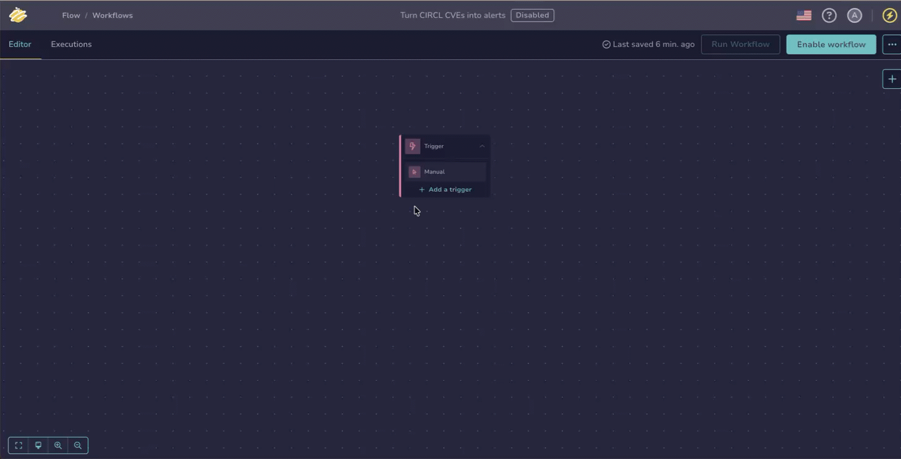

# Configure an Action Node

<!-- md:version 6.0 --> <!-- md:permission `manageOrchestrator/writeWorkflows` --> <!-- md:license One -->

Action nodes perform operations that interact with TheHive or external systems in [TheHive Flow](about-flow.md). They produce the workflow output by making changes in the environment or triggering downstream processes.

## Configure an *HTTP request* action node

An *HTTP request* action node sends HTTP requests to any API accessible from your TheHive instance:

* ITSM tools
* Threat intelligence platforms
* Cloud services
* Another TheHive Flow workflow with its *Webhook* trigger
* [TheHive API](https://docs.strangebee.com/thehive/api-docs/), for endpoints not covered by the [*TheHive* integration node](configure-integration-node.md#configure-a-thehive-integration-node)

!!! tip "Working with TheHive"
    To create, update, or query objects in TheHive, use the [*TheHive* integration node](configure-integration-node.md#configure-a-thehive-integration-node), which exposes TheHive operations directly. Use an *HTTP request* node for TheHive API endpoints that the *TheHive* node doesn't cover, or for any other external API.

!!! note "Targets on a private network"
    An *HTTP request* node can't reach non-public addresses, such as private, loopback, or link-local ranges: the step fails with an `egress guard` error. An administrator must first add the target range to the [egress allowlist](../configuration/flow-configuration.md#egress-allowlist).

1. 

2. Select a workflow from the list.

3. Drag the previous node connector to an empty area of the canvas.

    

4. In the **What is the next step?** drawer, select **Actions**.

5. Select *HTTP request*.

6. In the **HTTP request** drawer, enter the following information:

    

    *Fields marked with \* are mandatory.*

    **- Method \***

    The HTTP method used for the request.

    **- URL \***

    The full endpoint URL.

    Examples:

    * `https://<thehive_host>/api/v1/user`
    * `https://api.abuseipdb.com/api/v2/check?ipAddress=<ip_address>`

    **- Headers**

    

    **- Body**

    

    The request body. Available for the `POST`, `PUT`, `PATCH`, and `DELETE` methods.

    **- Multipart parts**

    Key-value pairs sent as a `multipart/form-data` request, one part per pair. Leave **Body** empty when using this field. The node streams a value that's a [file reference](about-flow.md#files) as a file part, and sends any other value as a plain form field. Available for the `POST`, `PUT`, `PATCH`, and `DELETE` methods.

7. Optional: Select **Add options** to configure the following settings.

    **- Authentication**

    Configure how the node authenticates when calling the target API.

    !!! tip "Calling TheHive API"
        If the HTTP request targets TheHive itself, make sure your [TheHive authentication settings](../../thehive/administration/authentication/configure-authentication.md) are compatible with the method you select in this node.

    Supported methods:

    * None: No authentication is added to the request.

    * Basic auth: Sends a username and password encoded in the `Authorization` header using the HTTP Basic scheme.

    | Field    | Example |
    | -------- | ------- |
    | Username * | `emma@example.com` |
    | Password * | `$secret.api_password` |

    * Bearer token: Sends an access token in the `Authorization` header using the Bearer scheme.

    | Field    | Example |
    | -------- | ------- |
    | Token * | `$secret.api_token` |

    * OAuth 2.0: Authenticates with an access token, provided directly or obtained by exchanging a refresh token.

    | Field    | With an access token | With a refresh token | Example |
    | -------- | -------------------- | -------------------- | ------- |
    | Client ID | Not used | Required | `$global.oauth_client_id` |
    | Client secret | Not used | Optional, for a confidential client | `$secret.oauth_client_secret` |
    | Access token | Required | Not used | `$secret.oauth_access_token` |
    | Refresh token | Not used | Required | `$secret.oauth_refresh_token` |
    | Token URL | Not used | Required | `https://auth.example.com/oauth/token` |

    !!! tip "Access token or refresh token"
        An access token is the short-lived key sent with each call to the service. A refresh token only serves to get new access tokens, and not every provider issues one.

        * Access token: Never renewed. Once it expires, calls fail until it's replaced. Suits a quick test.
        * Refresh token: Each node execution gets a fresh access token. Suits a workflow that runs over time. A new refresh token sent back by the provider isn't saved, so a provider that accepts each refresh token only once rejects the next execution.

    The form also shows **Authorization URL** and **Token scopes**, which have no effect: leave them empty.

    **- Proxy**

    

    A custom proxy on a non-public address must first be added to the [egress allowlist](../configuration/flow-configuration.md#egress-allowlist).

    **- SSL**

    

    **- Request timeout**

    Maximum time for the HTTP call itself. When a node timeout is also set in **Timeout & retry**, the shorter of the two applies. The value can't exceed the node timeout or the workflow timeout. The node retries when it reaches the node timeout and retries are configured, but not when it reaches the request timeout.

    **- Timeout & retry**

    Configure how the node handles execution time limits and failure recovery.

    

    Even without a node timeout, the HTTP call itself stops after the **Request timeout**, 30 seconds by default.

    **- Execution configuration**

    

8. Optional: Turn on **Ignore HTTP errors** to make the node succeed regardless of the response status code.

    By default, the node fails when the response returns a `4xx` or `5xx` error status code. With the option on, handle errors in the workflow, for example with an [*If* flow node](configure-flow-node.md#configure-an-if-flow-node) evaluating the `code` output.

    Two cases still fail the node:

    * A transport failure, such as a DNS, connection, TLS, or timeout error. The node sets no output.
    * A response announced as JSON that can't be parsed. The node sets the `code` and `headers` outputs but no `body`, and doesn't retry.

    When **Ignore HTTP errors** is off, the node retries a `408`, `429`, or `5xx` response up to the number of times set in **Retry attempts**, under **Timeout & retry**. Any other `4xx` response fails the node immediately, without retrying. When the called service includes a `Retry-After` header in its response, the node waits that long before the next attempt, up to a maximum of 5 minutes. This wait replaces the delay set by **Retry delay** and **Backoff**.

!!! info "Execution outputs"

    When executed, the node returns the following outputs. Each output is a JSON value:

    | Output    | Type   | Description                                      |
    |-----------|--------|--------------------------------------------------|
    | `body`    | any    | The response body returned by the target API. The node parses a response with a JSON content type to its value, and returns any other response as text. Not set for a multipart response: use `parts` instead. |
    | `code`    | number | The HTTP status code returned by the server.     |
    | `headers` | object | The response headers returned by the server.     |
    | `parts`   | object | The parts of a multipart response body, keyed by part name. Each part carries its `filename`, `content_type`, `size`, and `content`. Empty when the response isn't multipart. |

    A `body` that is large or binary, and a part `content` that is large or not JSON, are [stored as files](about-flow.md#files) and returned as file references. A part stored as a file also carries a `sha256sum` field, and a part name reused across parts is suffixed with `_2`, `_3`, and so on.

    To access outputs, select your *HTTP request* node and then select :fontawesome-solid-diagram-next: in the top-right corner of the screen. Hover over each output name to view its details.

    These outputs can then be reused as output variables in subsequent nodes, using the **$var** button or by entering `$` and selecting the output from the suggestions. Inserted references are displayed in the following form:
    
    * `$<node_name>.body.<field_name>`: to get a nested value from the response body
    * `$<node_name>.code`: to get the HTTP status code, for example to check whether the request succeeded
    * `$<node_name>.headers.<header_name>`: to get a specific response header
    * `$<node_name>.parts.<part_name>.content`: to get the content of one part of a multipart response

## Configure a *Send email* action node

A *Send email* action node sends an email using [the SMTP configuration defined in TheHive](../../thehive/administration/smtp/about-smtp.md), unless TheHive Flow has an [email server override](../configuration/flow-configuration.md#email-server-override).

!!! warning "Prerequisite"
    Before using a *Send email* action node, you must [configure an SMTP server in TheHive](../../thehive/administration/smtp/configure-smtp-server.md) or set an [email server override](../configuration/flow-configuration.md#email-server-override). The node can't send emails without a working SMTP configuration.

1. 

2. Select a workflow from the list.

3. Drag the previous node connector to an empty area of the canvas.

    

4. In the **What is the next step?** drawer, select **Actions**.

5. Select *Send email*.

6. In the **Send email** drawer, enter the following information:

    

    *Fields marked with \* are mandatory.*

    **- From \***

    The email address used as the sender.

    **- To \***

    One or more recipient addresses, separated by commas.

    **- Cc**

    Additional recipients.

    **- Bcc**

    Hidden recipients.

    **- Subject**

    The email subject.

    **- Body format**

    Select how the message body is sent:  

    * *Text*  
    * *HTML*  
    * *Both*: Sends both versions. This is the default, and it's recommended for maximum compatibility with email clients.

    **- Text body**

    The plain text content of the email.

    **- HTML body**

    The HTML content of the email.

7. Optional: Select **Add options** to configure the following settings.

    **- Timeout & retry**

    Configure how the node handles execution time limits and failure recovery.

    

    **- Execution configuration**

    

## Configure an *Analyzer* action node

An *Analyzer* action node triggers a [Cortex analyzer](../../thehive/administration/cortex/about-cortex.md) on a specific observable and makes the resulting report available as an output variable for use in subsequent workflow steps.

!!! warning "Prerequisite"
    To use an *Analyzer* action node, a Cortex server must already be connected to TheHive. If no Cortex instance is configured, follow the instructions in [Add a Cortex Server](../../thehive/administration/cortex/add-a-cortex-server.md) before proceeding.

1. 

2. Select a workflow from the list.

3. Drag the previous node connector to an empty area of the canvas.

    

4. In the **What is the next step?** drawer, select **Actions**.

5. Select *Analyzer*.

6. In the **Analyzer** drawer, enter the following information:

    

    *Fields marked with \* are mandatory.*

    **- Observable type \***

    The type of observable to analyze. Two input modes are available:

    * *Form*: Select the type from a list.
    * *Raw*: Provide the type with a [variable](about-flow.md#variables), when it's only known at runtime from a previous node's output.

    **- Observable ID \***

    The identifier of the observable to analyze.

    **- Analyzer \***

    Select the Cortex analyzer to run.

    The list shows only analyzers compatible with the selected [observable type](../../thehive/user-guides/analyst-corner/cases/observables/about-observables.md#type). Cortex checks the [Traffic Light Protocol (TLP)](https://www.misp-project.org/taxonomies.html#_tlp){target=_blank} and [Permissible Actions Protocol (PAP)](https://www.misp-project.org/taxonomies.html#_pap){target=_blank} levels of the observable at execution time: if they aren't compatible with the analyzer, it returns an error and the node fails.

    The list covers the analyzers of every Cortex instance connected to the organization. You don't select the instance: the node derives it from the analyzer you choose. When several instances host the same analyzer, the node uses the first one and gives no way to choose another. To target a specific instance, use the [*TheHive*](configure-integration-node.md#configure-a-thehive-integration-node) integration node with the *Run Analyzer on Observable* action, which takes the Cortex instance identifier as a value.

7. Optional: Select **Add options** to configure the following settings.

    **- Timeout & retry**

    Configure how the node handles execution time limits and failure recovery.

    

    **- Execution configuration**

    

!!! info "Execution output"

    When executed, the node runs the selected analyzer on the observable. The analyzer's report is available as an output object.

    To access the output, select your *Analyzer* node and then select :fontawesome-solid-diagram-next: in the top-right corner of the screen. Hover over the output name to view its details.

    This output can then be reused as an output variable in subsequent nodes, using the **$var** button or by entering `$` and selecting the output from the suggestions. The inserted reference is displayed as `$<node_name>.analyzer_report`.
    
    It contains the full report returned by Cortex, in the format specific to the analyzer that was run. Use a [*Set local variable*](configure-transformation-node.md#configure-a-set-local-variable-node) node, a [*JavaScript code*](configure-transformation-node.md#configure-a-javascript-code-node) node, or a [*Python code*](configure-transformation-node.md#configure-a-python-code-node) node to extract specific fields from it.

## Configure a *Responder* action node

A *Responder* action node triggers a [Cortex responder](../../thehive/administration/cortex/about-cortex.md) on a specific [alert](../../thehive/user-guides/analyst-corner/alerts/about-alerts.md), [case](../../thehive/user-guides/analyst-corner/cases/about-cases.md), [observable](../../thehive/user-guides/analyst-corner/cases/observables/about-observables.md), [task](../../thehive/user-guides/analyst-corner/tasks/about-tasks.md), or [task log](../../thehive/user-guides/analyst-corner/tasks/about-task-logs.md). When the node runs, it executes the selected responder and makes the resulting report available as an output variable for use in subsequent workflow steps.

!!! warning "Prerequisite"
    To use a *Responder* action node, a Cortex server must already be connected to TheHive. If no Cortex instance is configured, follow the instructions in [Add a Cortex Server](../../thehive/administration/cortex/add-a-cortex-server.md) before proceeding.

1. 

2. Select a workflow from the list.

3. Drag the previous node connector to an empty area of the canvas.

    

4. In the **What is the next step?** drawer, select **Actions**.

5. Select *Responder*.

6. In the **Responder** drawer, enter the following information:

    

    *Fields marked with \* are mandatory.*

    **- Entity type \***

    The type of entity on which the responder runs. Each entity type has its own value: `alert` for an [alert](../../thehive/user-guides/analyst-corner/alerts/about-alerts.md), `case` for a [case](../../thehive/user-guides/analyst-corner/cases/about-cases.md), `case_artifact` for an [observable](../../thehive/user-guides/analyst-corner/cases/observables/about-observables.md), `case_task` for a [task](../../thehive/user-guides/analyst-corner/tasks/about-tasks.md), and `case_task_log` for a [task log](../../thehive/user-guides/analyst-corner/tasks/about-task-logs.md).

    Two input modes are available:

    * *Form*: Select the type from a list. The list is built from the entity types declared by the responders of the connected Cortex instances, so a type appears only when at least one enabled responder supports it.
    * *Raw*: Enter the type directly or provide it with a [variable](about-flow.md#variables), when it's only known at runtime from a previous node's output or missing from the list.

    **- Entity ID \***

    The identifier of the entity to process.

    **- Responder \***

    Select the Cortex responder to execute.

    The list shows only responders compatible with the selected entity type. Cortex checks the [TLP](https://www.misp-project.org/taxonomies.html#_tlp){target=_blank} and [PAP](https://www.misp-project.org/taxonomies.html#_pap){target=_blank} levels of the entity at execution time: if they aren't compatible with the responder, it returns an error and the node fails.

7. Optional: Select **Add options** to configure the following settings.

    **- Timeout & retry**

    Configure how the node handles execution time limits and failure recovery.

    

    **- Execution configuration**

    

!!! info "Execution output"

    When executed, the node runs the selected responder on the selected alert, case, observable, or task. The responder's report is available as an output object.

    To access the output, select your *Responder* node and then select :fontawesome-solid-diagram-next: in the top-right corner of the screen. Hover over the output name to view its details.

    This output can then be reused as an output variable in subsequent nodes, using the **$var** button or by entering `$` and selecting the output from the suggestions. The inserted reference is displayed as `$<node_name>.responder_report`.
    
    It contains the full report returned by Cortex, in the format specific to the responder that was run. Use a [*Set local variable*](configure-transformation-node.md#configure-a-set-local-variable-node) node, a [*JavaScript code*](configure-transformation-node.md#configure-a-javascript-code-node) node, or a [*Python code*](configure-transformation-node.md#configure-a-python-code-node) node to extract specific fields from it.

## Configure an *AI* action node

An *AI* action node sends a message to a large language model (LLM) and returns its response. Use it to triage alerts, summarize case data, classify observables, or draft content as part of a workflow. The node calls an OpenAI-compatible [LLM provider configured by your administrator](../../thehive/administration/manage-llm-providers.md).

!!! warning "Prerequisite"
    An administrator must [configure at least one LLM provider](../../thehive/administration/manage-llm-providers.md) before using an *AI* action node.

!!! note "Locally hosted LLM providers"
    An *AI* node can't reach a provider on a non-public address: the step fails with an `egress guard` error. For a provider hosted on your internal network, an administrator must first add its address range to the [egress allowlist](../configuration/flow-configuration.md#egress-allowlist).

1. 

2. Select a workflow from the list.

3. Drag the previous node connector to an empty area of the canvas.

    

4. In the **What is the next step?** drawer, select **Actions**.

5. Select *AI*.

6. In the **AI** drawer, enter the following information:

    

    *Fields marked with \* are mandatory.*

    **- Role and context**

    Defines the posture and context the AI adopts. For example: `You are a security analyst specialized in alert triage.`

    **- Message \***

    The concrete instruction to execute. Phrase the request here and inject the data to analyze from upstream nodes, for example `Analyze this alert and decide whether to escalate or discard: $input.alert`.

    **- Provider \***

    The LLM provider to use. Available providers depend on the [configuration set by your administrator](../../thehive/administration/manage-llm-providers.md).

    **- Model \***

    The model that generates the response, selected from the models available for the chosen provider.

    **- Output schema**

    A JSON schema describing the expected output structure. When set, the AI constrains its response to match the schema, so downstream nodes can consume the fields individually. The field opens pre-filled with a schema declaring a single `message` string field. You can clear it: when the field is empty, the node produces no `result` output and only the raw `response` text is available.

7. Optional: Select **Add options** to configure the following sections.

    **- Model parameters**

    **Temperature**: Controls how random the response is, from `0` to `2`. Lower values make the response more focused and deterministic. Higher values make it more varied. Leave empty to use the model default.

    **Max tokens**: The maximum number of tokens in the response. Leave empty to use the provider default.

    **Reasoning effort**: How much reasoning the model spends before answering: *None*, *Minimal*, *Low*, *Medium*, *High*, *Extra high*, or *Max*. *None* turns reasoning off, and the levels a model accepts depend on the provider. Leave empty to use the configuration default, then the provider default.

    **- Timeout & retry**

    Configure how the node handles execution time limits and failure recovery.

    

    **- Execution configuration**

    

!!! info "Execution outputs"

    When executed, the node returns the following outputs. Each output is a JSON value:

    | Output          | Type   | Description                                                                 |
    |-----------------|--------|-----------------------------------------------------------------------------|
    | `response`      | string | The raw text response from the LLM.                                         |
    | `result`        | object | The parsed structured output. Present only when an output schema is set. |
    | `message`       | object | The raw assistant message returned by the LLM, including reasoning content when the model provides it. |
    | `finish_reason` | string | The reason the LLM stopped generating, for example `stop`, `length`, `tool_calls`, or `content_filter`. |
    | `usage`         | object | Token usage for the call: `prompt_tokens`, `completion_tokens`, and `total_tokens`. |

    To access outputs, select your *AI* node and then select :fontawesome-solid-diagram-next: in the top-right corner of the screen. Hover over each output name to view its details.

    These outputs can then be reused as output variables in subsequent nodes, using the **$var** button or by entering `$` and selecting the output from the suggestions. Inserted references are displayed in the following form:

    * `$<node_name>.response`: to get the text response
    * `$<node_name>.result.<field_name>`: to get a field from the structured output when an output schema is set
    * `$<node_name>.finish_reason`: to check why the LLM stopped generating, for example in an *If* condition
    * `$<node_name>.usage.total_tokens`: to get the total token usage of the call

<h2>Next steps</h2>

* [Manage Global Variables](manage-global-variables.md)
* [Add a Trigger](add-trigger.md)
* [Configure an Integration Node](configure-integration-node.md)
* [Configure a Transformation Node](configure-transformation-node.md)
* [Configure a Flow Node](configure-flow-node.md)
* [Manually Run a Workflow](manually-run-workflow.md)