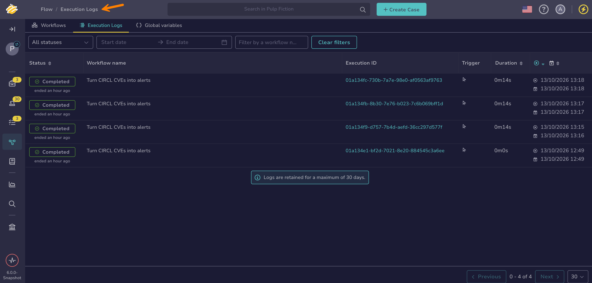
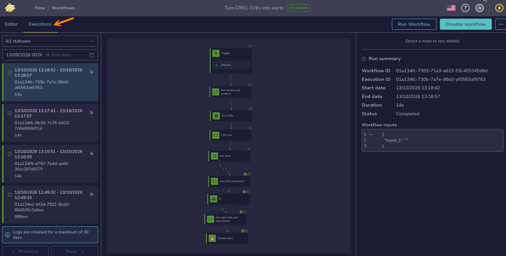
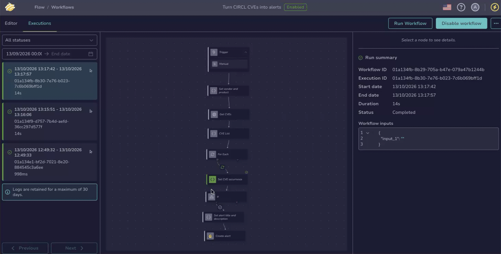
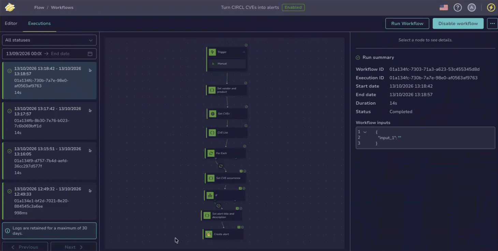

# Display Workflow Execution Logs

<!-- md:version 6.0 --> <!-- md:permission `manageOrchestrator/readWorkflows` --> <!-- md:permission `manageOrchestrator/writeWorkflows` --> <!-- md:license One -->

Use execution logs to inspect how a workflow ran for each node. They help debug a workflow that isn't behaving as expected.

Execution logs are available in three places:

* The **Execution logs** tab in the **Flow** view gives an organization-wide overview of the runs of every workflow.
* The **Executions** tab inside a specific workflow shows the runs of that workflow in detail and lets you run it and inspect each node.
* The Automation Center of a case or alert in TheHive, in its **Automations** tab, lists the runs launched on that case or alert.

## Display execution logs for all workflows

The **Execution logs** tab in the **Flow** view lists the executions of every workflow in the organization for the configured [retention period](../configuration/flow-configuration.md#run-retention). It includes runs launched by a trigger, or manually from the workflow editor or a case or alert. It doesn't include the runs of workflows called by a [*Subworkflow* node](configure-flow-node.md#configure-a-subworkflow-flow-node). Open those from the run of the calling workflow. Use it as a starting point to spot failures and jump into a specific run.

1. 

2. Go to the **Execution logs** tab.

    The tab lists the executions of all workflows, with the following columns:

    * Status: Whether the execution completed, failed, was canceled, terminated, timed out, or is still in progress
    * Workflow name: The workflow the execution belongs to
    * Execution ID: The unique identifier of the run
    * Trigger: An icon showing what started the run, either **Manual**, **Webhook**, or **Scheduler**
    * Duration: How long the execution took
    * Start date and end date: When the execution started and finished

    

3. Select an **Execution ID** to open the detailed execution view for that run, where you can inspect each node as described in [Display execution logs for a specific workflow](#display-execution-logs-for-a-specific-workflow).

This tab is a read-only overview. To run a workflow or step through its nodes, open the workflow and use its **Executions** tab.

## Display execution logs for a specific workflow

The **Executions** tab inside a workflow lists the runs of that workflow, whether launched by a trigger, or manually from the workflow editor or a case or alert. It doesn't include the runs in which the workflow was called by a [*Subworkflow* node](configure-flow-node.md#configure-a-subworkflow-flow-node). Open those from the run of the calling workflow. Use it when you know which workflow to inspect. It lets you run the workflow and inspect the execution node by node on the canvas.

1. 

2. Select the workflow whose execution logs you want to review.

3. Go to the **Executions** tab.

    The tab lists the executions of the workflow from the last 30 days by default. Change the date range filter to see older ones still retained. Each run shows its status, start and end dates, unique ID, duration, and the trigger that started it. A run still in progress shows only its start date. You can filter by status and date range.

    

4. Select **Run workflow** to follow the execution of each node in real time.

    

5. Select a run to display its **Run summary**. It stays displayed until you select a node and includes:

    * Status, workflow ID, execution ID, start date, end date, and duration of the run
    * Failed steps: The nodes that failed, with their error message. Select one to open its execution details.
    * Workflow inputs: The value each [input variable](manage-input-exit-variables.md) got for this run. Displayed only when the workflow declares input variables.
    * Workflow outputs: The value of each [exit variable](manage-input-exit-variables.md). Displayed only when the workflow declares exit variables and the run completed.

6. Select a node to view its execution details:

    * Start date, end date, and duration: How long the node took to run
    * Status: Whether the node completed, failed, was canceled, or timed out. Nodes that didn't run stay gray on the canvas.
    * Error message: Displayed if the node encountered an error
    * Input and output data: The data passed into and returned by the node. The value of a [secret global variable](manage-global-variables.md) never appears in the execution data.

7. Select the trigger node to see what started the run.

    On the canvas, the trigger node shows only the trigger that started the run, either **Manual** or the name of the *Webhook* or *Scheduler* trigger. Its execution details include the start date, end date, duration, and status, along with data that depends on how the run started:

    * [Manual run](manually-run-workflow.md): **Input** displays the raw data the run received when it started, known as the [trigger payload](access-trigger-payload.md). **Output** displays the value each [input variable](manage-input-exit-variables.md) got for this run, which is what the next nodes receive.
    * *Webhook* trigger: The same data as a manual run, with a **Response code**. Only requests answered with `200` start a run, so the code is always `200`.
    * *Scheduler* trigger: **Current interval** describes the schedule. It reflects the trigger's current configuration, so it no longer matches the run if the schedule was edited since. No **Input** or **Output** is displayed.

8. For a node that runs inside a *For each* loop, select an iteration from the **Select an execution** dropdown to inspect a single run of that node.

    Each iteration is listed by its number, starting with **Execution 1**. Selecting or hovering over an iteration highlights the nodes and branches that ran during that iteration on the canvas. For nested loops, drill down into an iteration to reach its inner iterations.

    

9. For a [*Subworkflow* node](configure-flow-node.md#configure-a-subworkflow-flow-node), select the name of the called workflow in the **Workflow** row of the node execution details. The run of the called workflow opens in a new tab.

    The link appears once the called workflow has started. If the called workflow was deleted since the run, the row reads **Deleted workflow**. The input data of the node displays the called workflow, the value sent to each of its input variables, and the [trigger payload](access-trigger-payload.md) it received. The output data displays the [exit variables](manage-input-exit-variables.md) it returned.

    !!! info "Runs of called workflows"
        Canceling the run of a called workflow also stops the run of the calling workflow. Once the run of the called workflow is past the [retention period](../configuration/flow-configuration.md#run-retention), it can no longer be opened, but the *Subworkflow* node keeps its input and output data.

Executions can't be resumed from a failed node. Fix the issue, then re-run the workflow from the beginning by selecting **Run workflow**. While an execution is still running, select it, then select **Cancel** to stop it early.

## Display execution logs from a case or alert

Workflows can be run from the **Flow** view or [from a case or alert page in TheHive](manually-run-workflow.md#run-a-workflow-from-a-case-or-alert). The Automation Center of a case or alert, in its **Automations** tab, lists the workflow runs launched on that entity. Use it when the workflow was run from the case or alert. Runs started from the **Flow** view or a trigger aren't tied to a case or alert and appear only in the **Flow** view logs.

1. Open a case or an alert.

2. Go to the **Automations** tab.

3. Select the **Workflows** tab.

    The tab lists the workflow runs launched on the case or alert, with the following columns:

    * Status: Whether the run completed, failed, was canceled, terminated, timed out, or is still in progress
    * Name: The workflow the run belongs to
    * Execution ID: The unique identifier of the run. Select it to open the run in the **Flow** view in a new tab.
    * Triggered by: Who started the run
    * Start date: When the run started

    

<h2>Next steps</h2>

* [Manage Workflows](manage-workflows.md)
* [Manually Run a Workflow](manually-run-workflow.md)
