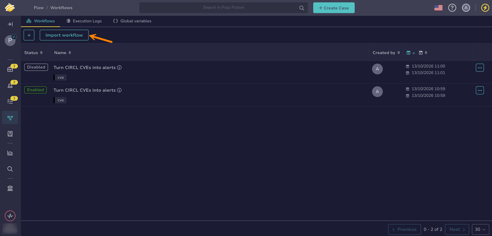

# Export or Import a Workflow

<!-- md:version 6.0 --> <!-- md:license One -->

Workflows in [TheHive Flow](about-flow.md) exist at the organization level. You can transfer workflows between different TheHive instances or organizations by exporting and importing them. Importing is also how you bring a ready-made [workflow template](workflow-templates.md) into your organization.

TheHive Flow has no native versioning. To maintain a change history, the recommended strategy is to export workflows and commit them to a Git repository.

## Export a workflow

<!-- md:permission `manageOrchestrator/writeWorkflows` -->

Share a workflow with another organization or TheHive instance.

1. 

2. In the workflow list, select :fontawesome-solid-ellipsis: next to the workflow you want to export.

3. Select **Export**.

Your workflow downloads as a YAML file. The file contains the workflow nodes, variables, and settings. It doesn't contain the *Webhook* and *Scheduler* [triggers](add-trigger.md) of the workflow.

## Import a workflow

<!-- md:permission `manageOrchestrator/writeWorkflows` -->

Use a workflow from another organization or TheHive instance, or a ready-made [workflow template](workflow-templates.md).

1. 

2. Select **Import workflow**.

    

3. In the **Import workflow** drawer, drop a YAML file or select it from your computer. Use the file you obtained from [exporting a workflow](#export-a-workflow), or the file you saved from a [workflow template](workflow-templates.md).

4. Optional: In the **Name** field, enter a new name for the imported workflow.

5. Select **Import**.

The imported workflow starts turned off and has no *Webhook* or *Scheduler* trigger. Review it, [add the triggers](add-trigger.md) it needs, then [enable it](manage-workflows.md#enable-a-workflow).

!!! note "Workflows with a *Subworkflow* node"
    A [*Subworkflow* node](configure-flow-node.md#configure-a-subworkflow-flow-node) refers to the workflow it calls by its identifier, which differs in each organization. After importing a workflow that contains one, import the called workflow too if needed, then select it again in each *Subworkflow* node.

<h2>Next steps</h2>

* [Workflow Templates](workflow-templates.md)
* [Manage Workflows](manage-workflows.md)