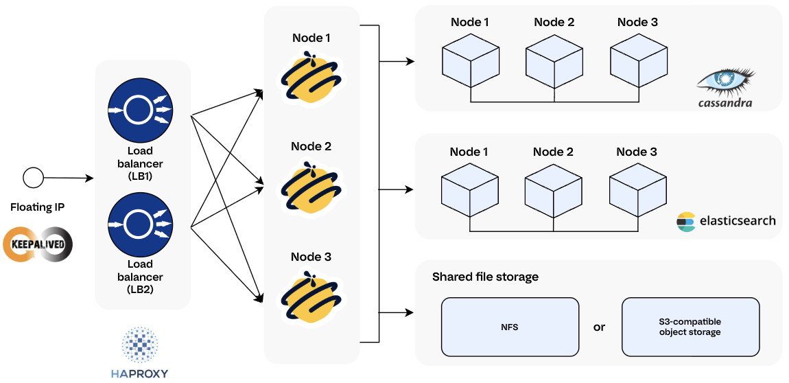

# Set Up a Cluster with Packages

<!-- md:version 5.4 -->

!!! note "Guide scope"

    * This documentation applies to TheHive versions 5.4 and later. For earlier versions, [refer to the Akka Configuration](../configuration/akka.md).
    * This documentation applies to a fresh installation of a new instance.

Set up a fault-tolerant cluster for TheHive. Each cluster comprises three active nodes, featuring:

* Cassandra for the database
* Elasticsearch for the indexing engine
* NFS or S3-compatible object storage for file storage
* TheHive
* HAProxy for load balancing
* Keepalived for virtual IP setup

!!! info "Deployment layout"
    You can install these applications on separate servers or on the same server. The examples in this guide use three separate servers.

!!! warning "Single data center only"
    TheHive doesn't support clusters with nodes spread across multiple data centers, including Cassandra and Elasticsearch nodes. Deploy all cluster nodes in the same data center.

!!! warning "Before you begin"

    * Verify that all [system requirements for package installation](system-requirements.md) are met on every node.
    * Ensure that Python 3.9 is available for using the Cassandra Query Language (CQL) shell `cqlsh`. Later Python versions aren't compatible.



## Architecture diagram

{ width=70% .center }

The diagram above shows the key components and their interactions.

Each component has a specific role:

* Keepalived manages a virtual IP address to provide automatic failover and maintain service continuity.
* HAProxy distributes incoming requests across TheHive nodes to improve availability and handle node failures transparently.
* Cassandra ensures durable and consistent storage of TheHive data across nodes.
* Elasticsearch enables efficient indexing and fast search capabilities.
* Shared file storage centralizes attachments and file-type observables, making them available to all cluster nodes.
* TheHive nodes run the application logic and coordinate incident response workflows and collaboration.

---

## Step 1: Set up the Java virtual machine (JVM)

TheHive and Cassandra both run on the JVM but require different versions: TheHive 6.x runs on Java 17, while Cassandra 4.0.x to 4.1.x requires Java 11 and doesn't support Java 17. This dual-version setup applies to TheHive 6.x only. To install TheHive 5.x, Java 11 alone is required on every node.

* On nodes running Cassandra, install Java 11 and keep it as the system default.
* On nodes running TheHive, install Java 17. TheHive service is pinned to it at [Step 5.2](#configure-jvm-options-for-thehive).
* On nodes running both, install the two versions side by side: Java 11 stays the system default for Cassandra, and TheHive service alone is pinned to Java 17.

Follow [Run TheHive 6 and Cassandra on the Same Host](../operations/thehive-6-cassandra-same-host.md) to install both versions with Amazon Corretto, running the commands on every node and keeping only the version each node needs when the components run on separate servers.

---

## Step 2: Install and configure Apache Cassandra

When configuring a Cassandra cluster, the goal is a setup comprising three active nodes with a replication factor of `3`: data is replicated across each node, so the cluster tolerates the failure of a single node. If one node experiences hardware issues or network disruptions, the other two nodes continue to store and process incident data.

!!! info "Network environment"
    All nodes must reside within the same network and the same data center. Ideally, deploy the nodes in different racks within that data center.

### Step 2.1: Install Cassandra

Install Cassandra on each node, following the steps in the [installation guide](installation-guide-linux-standalone-server.md#step-31-install-cassandra).

!!! info "Node definition"
    A node in this context refers to each server or machine designated to participate in the Cassandra cluster.

### Step 2.2: Configure Cassandra

On each node in the Cassandra cluster, update the configuration files as follows:

1. Update the Cassandra configuration file.

    Open the `/etc/cassandra/cassandra.yaml` file on each node using a text editor:

    ```yaml hl_lines="13"
    cluster_name: 'thp'
    num_tokens: 4
    authenticator: PasswordAuthenticator
    authorizer: CassandraAuthorizer
    role_manager: CassandraRoleManager
    data_file_directories:
        - /var/lib/cassandra/data
    commitlog_directory: /var/lib/cassandra/commitlog
    saved_caches_directory: /var/lib/cassandra/saved_caches
    seed_provider:
        - class_name: org.apache.cassandra.locator.SimpleSeedProvider
        parameters:
            - seeds: "<ip_node_1>, <ip_node_2>, <ip_node_3>"
    listen_interface : eth0
    rpc_interface: eth0
    endpoint_snitch: GossipingPropertyFileSnitch
    ```

    * Cluster name: Set the name of the Cassandra cluster.
    * Number of tokens: Configure the number of tokens for each node.
    * Authentication and authorization: Specify the authenticator, authorizer, and role manager.
    * Directories: Define directories for data, commit logs, and saved caches.
    * Seed provider: List all IP addresses of nodes included in the cluster.
    * Network interfaces: Set up the appropriate network interfaces.
    * Endpoint snitch: Specify the snitch for determining network topology.

    Replace `<ip_node_1>`, `<ip_node_2>`, and `<ip_node_3>` with the IP addresses of all the nodes included in the cluster, and set `listen_interface` and `rpc_interface` to the network interface name of the node, `eth0` in this example.

    !!! info "Parameter details"
        For detailed explanations of each parameter in the YAML file, refer to the [Cassandra configuration section](installation-guide-linux-standalone-server.md#step-33-configure-cassandra).

2. Delete the Cassandra topology properties file.

    Remove the `cassandra-topology.properties` file to prevent any conflicts:

    ```
    rm /etc/cassandra/cassandra-topology.properties
    ```

3. Configure the Cassandra GossipingPropertyFileSnitch.

    On each node, edit the `/etc/cassandra/cassandra-rackdc.properties` file to assign the datacenter and rack names:

    ```yaml
    ## On node 1
    dc=datacenter1
    rack=rack1

    ## On node 2
    dc=datacenter1
    rack=rack2

    ## On node 3
    dc=datacenter1
    rack=rack3
    ```

### Step 2.3: Configure JVM options for Cassandra

The JVM options control how much memory Cassandra can use, how it manages that memory, and other performance-related settings. By default, Java determines heap size automatically, which isn't recommended for production environments and may cause memory contention or out-of-memory errors.

Check if the `/etc/cassandra/jvm-server.options` file exists. If it doesn't, create it, then open it using a text editor and set the JVM options.

!!! tip "Heap size guidelines for Cassandra"
    Heap allocation [must not exceed 50% of the available RAM and should not be less than 2 GB](https://cassandra.apache.org/doc/stable/cassandra/managing/operating/hardware.html#memory){target=_blank}. Available RAM refers to the memory remaining after accounting for the operating system and other services running on the same host.

```yaml
-Xms<heap_size>
-Xmx<heap_size>
-Xmn<young_gen_size>
```

Replace `<heap_size>` with the desired heap size and `<young_gen_size>` with the desired young generation size. `Xms` sets the initial heap size, `Xmx` sets the maximum, and `Xmn` sets the size of the young generation, where short-lived objects are allocated.

Repeat this step on each node.



### Step 2.4: Start the nodes

To start the Cassandra service on each node, follow these steps:

1. Start the Cassandra service.

    Run the following command on each node, one at a time:

    ```bash
    sudo systemctl start cassandra
    ```

2. Enable the Cassandra service to restart automatically after a system reboot.

    ```bash
    sudo systemctl enable cassandra
    ```

3. Verify node status.

    Check that all nodes are up and running using the `nodetool status` command:

    ```bash
    root@cassandra:/# nodetool status
    Datacenter: datacenter1
    ===============
    Status=Up/Down
    |/ State=Normal/Leaving/Joining/Moving
    --  Address      Load       Tokens       Owns (effective)  Host ID                               Rack
    UN  <ip_node_1>  776.53 KiB  256          100.0%            a79c9a8c-c99b-4d74-8e78-6b0c252abd86  rack1
    UN  <ip_node_2>  671.72 KiB  256          100.0%            8fda2906-2097-4d62-91f8-005e33d3e839  rack1
    UN  <ip_node_3>  611.54 KiB  256          100.0%            201ab99c-8e16-49b1-9b66-5444044fb1cd  rack1
    ```

### Step 2.5: Initialize the database



To initialize the database:

1. Connect to Cassandra using default credentials.

    On one of the nodes, access the Cassandra Query Language (CQL) shell by running the following command, providing the IP address of the respective node:

    ```bash
    cqlsh <ip_node_X> -u cassandra -p cassandra
    ```

    !!! info "Cqlsh may not be available on RPM-based systems"
        On some RPM-based distributions, the `cqlsh` client isn't included with the `cassandra` package. If running cqlsh gives an error, download the [official Apache Cassandra tarball](https://downloads.apache.org/cassandra/){target=_blank} that matches your server version and extract it. Then run the bundled client: `./bin/cqlsh <ip_node_X> -u cassandra -p cassandra`.

2. Configure the system authentication replication.

    Before creating new roles, modify the default replication factor for the `system_auth` keyspace using the following CQL command:

    ```sql
    ALTER KEYSPACE system_auth WITH replication = {'class': 'NetworkTopologyStrategy', 'replication_factor': 3 };
    ```

3. Create a new administrator role.

    To avoid relying on the default `cassandra` superuser account, create a new administrator role and then delete the default user.

    a. Create the `admin` role.

    ```sql
    CREATE ROLE admin WITH PASSWORD = '<authentication_admin_password>' AND LOGIN = true AND SUPERUSER = true;
    ```

    Replace `<authentication_admin_password>` with the password you intend to use for the `admin` superuser account.

    b. Disconnect from the session by pressing **Ctrl+D**, then reconnect as the new admin.

    ```bash
    cqlsh <ip_node_X> -u admin
    ```

    c. Remove the default `cassandra` user.

    ```sql
    DROP ROLE cassandra;
    ```

4. Create the `thehive` keyspace.

    A keyspace is the Cassandra equivalent of a database. Create a keyspace named `thehive` with a replication factor of `3` and durable writes enabled:

    ```sql
    CREATE KEYSPACE thehive WITH replication = {'class': 'NetworkTopologyStrategy', 'replication_factor': '3' } AND durable_writes = 'true';
    ```

5. Create a dedicated role for TheHive and grant permissions.

    Finally, create a role named `thehive` and grant permissions on the `thehive` keyspace.

    ```sql
    CREATE ROLE thehive WITH LOGIN = true AND PASSWORD = '<thehive_role_password>';
    GRANT ALL PERMISSIONS ON KEYSPACE thehive TO 'thehive';
    ```

    Replace `<thehive_role_password>` with the password you intend to use for the `thehive` role.

    !!! tip "Note this password"
        Keep this password secure. You'll need to enter it later in TheHive configuration file so the application can connect to the Cassandra database.

!!! tip "Cassandra cluster maintenance"
    In a Cassandra cluster, regular repairs are required to maintain data consistency between nodes. Automate a full repair with `nodetool repair -full`, for example by running it weekly using `cron`. Failing to run regular repairs can lead to inconsistent data, read errors, and authorization issues over time.

### (Optional) Step 2.6: Enable encryption for client and inter-node communication

Enable encrypted communication between client machines and the database cluster, and between the nodes of the cluster.

#### Client to node encryption

!!! note "Prerequisite"
    Configure the necessary certificates for encryption, keystores and truststores, before you begin.

1. Open the `cassandra.yaml` configuration file and edit the `client_encryption_options` section.

    ```yaml hl_lines="4 7"
    client_encryption_options:
    enabled: true
    optional: false
    keystore: /path/to/<keystore_file>
    keystore_password: <keystore_password>
    require_client_auth: true
    truststore: /path/to/<truststore_file>
    truststore_password: <truststore_password>
    protocol: TLS
    algorithm: SunX509
    store_type: JKS
    cipher_suites: [TLS_RSA_WITH_AES_128_CBC_SHA, TLS_RSA_WITH_AES_256_CBC_SHA]
    ```

2. Restart the Cassandra service on all nodes.

    ```bash
    sudo systemctl restart cassandra
    ```

3. Check Cassandra logs.

    Review the Cassandra logs to ensure there are no errors related to SSL/TLS.

    ```bash
    tail -n 100 /var/log/cassandra/system.log | grep -iE "error|warning"
    ```

#### Inter-node encryption

!!! note "Prerequisite"
    Configure the necessary certificates for encryption, keystores and truststores, before you begin.

1. Open the `cassandra.yaml` configuration file and edit the `server_encryption_options` section.

    ```yaml hl_lines="3 5"
    server_encryption_options:
    internode_encryption: all
    keystore: /path/to/<keystore_file>
    keystore_password: <keystore_password>
    truststore: /path/to/<truststore_file>
    truststore_password: <truststore_password>
    protocol: TLS
    algorithm: SunX509
    store_type: JKS
    cipher_suites: [TLS_RSA_WITH_AES_128_CBC_SHA, TLS_RSA_WITH_AES_256_CBC_SHA]
    require_client_auth: true
    enabled: true
    ```

2. Restart the Cassandra service on all nodes.

    ```bash
    sudo systemctl restart cassandra
    ```

3. Check Cassandra logs.

    Review the Cassandra logs to ensure there are no errors related to SSL/TLS.

    ```bash
    tail -n 100 /var/log/cassandra/system.log | grep -iE "error|warning"
    ```

---

## Step 3: Install and configure Elasticsearch

!!! note "Elasticsearch supported versions"

    **TheHive**

    

    If using Elasticsearch for [audit log storage](installation-guide-linux-standalone-server.md#step-53-audit-log-storage), you must use Elasticsearch 7.17 or later.

    **Cortex**

    

    Sharing a single Elasticsearch instance between TheHive and Cortex isn't recommended. If you must do it, ensure the Elasticsearch version is compatible with both applications.

### Step 3.1: Install Elasticsearch

To establish a cluster of three active Elasticsearch nodes, follow the [installation instructions](./installation-guide-linux-standalone-server.md#step-41-install-elasticsearch) for each node.

### Step 3.2: Configure Elasticsearch

On each node, update the `/etc/elasticsearch/elasticsearch.yml` configuration file with the following parameters:

```yaml hl_lines="8"
http.host:  0.0.0.0
network.bind_host:  0.0.0.0
script.allowed_types:  inline,stored
cluster.name: thehive
node.name: 'es1'
path.data: /usr/share/elasticsearch/data
path.logs: /usr/share/elasticsearch/logs
network.host: 'es1'
http.port: 9200
cluster.initial_master_nodes:
  - es1
node.master: true
discovery.seed_hosts:
  - 'es1'
  - 'es2'
  - 'es3'
thread_pool.search.queue_size: 100000
thread_pool.write.queue_size: 100000
xpack.security.enabled: true
xpack.security.http.ssl.enabled: true
xpack.security.transport.ssl.enabled: true
xpack.security.http.ssl.key: /usr/share/elasticsearch/config/certs/es1/es1.key
xpack.security.http.ssl.certificate: /usr/share/elasticsearch/config/certs/es1/es1.crt
xpack.security.http.ssl.certificate_authorities: /usr/share/elasticsearch/config/certs/ca/ca.crt
xpack.security.transport.ssl.key: /usr/share/elasticsearch/config/certs/es1/es1.key
xpack.security.transport.ssl.certificate: /usr/share/elasticsearch/config/certs/es1/es1.crt
xpack.security.transport.ssl.certificate_authorities: /usr/share/elasticsearch/config/certs/ca/ca.crt
```

Replace `es1` with the IP address or host name of the respective node, in `node.name`, `network.host`, the certificate paths, and `cluster.initial_master_nodes`. Keep `discovery.seed_hosts` identical on all nodes to ensure proper cluster discovery.

!!! warning "X-Pack and SSL configuration"
    When configuring X-Pack and SSL with Elasticsearch, review the documentation specific to your Elasticsearch version for accurate setup instructions.

### Step 3.3: Configure JVM options for Elasticsearch

The JVM options control how much memory Elasticsearch can use, how it manages that memory, and other performance-related settings. By default, Java determines heap size automatically, which isn't recommended for production environments and may cause memory contention or out-of-memory errors.

Check if the `/etc/elasticsearch/jvm.options.d/jvm.options` file exists. If it doesn't, create it, then open it using a text editor and set the JVM options.

!!! tip "Heap size guidelines for Elasticsearch"
    Heap allocation [must not exceed 50% of the available RAM](https://www.elastic.co/search-labs/blog/elasticsearch-heap-size-jvm-garbage-collection){target=_blank}. Available RAM refers to the memory remaining after accounting for the operating system and other services running on the same host.

```yaml
-Dlog4j2.formatMsgNoLookups=true
-Xms<heap_size>
-Xmx<heap_size>
```

Replace `<heap_size>` with the desired heap size. `Xms` sets the initial heap size, and `Xmx` the maximum heap size.





Repeat this step on each node.



### Step 3.4: Start the nodes

To start the Elasticsearch service on each node, run the following commands:

```bash
sudo systemctl start elasticsearch
sudo systemctl enable elasticsearch
```

The first command starts the Elasticsearch service, allowing the node to join the cluster and begin handling data requests. The second enables the service to restart automatically after a system reboot.

### Step 3.5: Set a user with the right permissions for TheHive

The example configuration at [Step 3.2](#step-32-configure-elasticsearch) enables X-Pack security, so TheHive needs a dedicated Elasticsearch user to authenticate with. Create the user and its role through the Elasticsearch API: unlike the `elasticsearch-users` command used on a standalone server, which manages users in a file local to one node, the API stores them in the cluster itself, shared by every node.

The commands below run from one of the Elasticsearch nodes. With the TLS configuration of [Step 3.2](#step-32-configure-elasticsearch), the API answers over HTTPS: pass the certificate authority (CA) certificate with `--cacert`, using the path set in `xpack.security.http.ssl.certificate_authorities`.

1. Set a password for the built-in `elastic` superuser. Skip this step if the password is already set.

    ```bash
    sudo /usr/share/elasticsearch/bin/elasticsearch-reset-password -u elastic
    ```

2. Create a role with the privileges needed for TheHive: the `manage` cluster privilege and the `all` indices privilege on `thehive*` indices. For the details of why each privilege is needed, see [Step 4.4 of the installation guide](installation-guide-linux-standalone-server.md#step-44-permissions).

    ```bash
    curl -u elastic:<elastic_user_password> \
    --cacert /usr/share/elasticsearch/config/certs/ca/ca.crt \
    -X POST "https://<ip_es_node>:9200/_security/role/thehive_role" \
    -H "Content-Type: application/json" -d '
    {
      "cluster": ["manage"],
      "indices": [
        {
          "names": ["thehive*"],
          "privileges": ["all"]
        }
      ]
    }'
    ```

    Replace `<elastic_user_password>` with the password set in the previous step, and `<ip_es_node>` with the IP address or host name of the node.

    If successful, the command returns `{"role":{"created":true}}`.

3. Create the `thehive` user and assign the role.

    ```bash
    curl -u elastic:<elastic_user_password> \
    --cacert /usr/share/elasticsearch/config/certs/ca/ca.crt \
    -X PUT "https://<ip_es_node>:9200/_security/user/thehive" \
    -H "Content-Type: application/json" -d '
    {
      "password" : "<thehive_user_password>",
      "roles" : ["thehive_role"]
    }'
    ```

    Replace `<thehive_user_password>` with the password you intend to use for the `thehive` user.

    If successful, the command returns `{"created":true}`.

!!! tip "Note this password"
    Keep the `<thehive_user_password>` password secure. You'll need to enter it later in TheHive configuration file so the application can connect to Elasticsearch.

---

## Step 4: Set up a shared file storage

Shared file storage provides a common storage space used by all nodes. Several options are available.

=== "NFS"

    NFS is one of the simplest methods to implement shared file storage. With a single NFS endpoint, all nodes in the cluster access and share the same files.

    1. Mount the NFS endpoint to `/opt/thp/thehive/files` on each node.
    2. Set permissions: ensure the `thehive` user has both read and write access to this directory, including the ability to create subdirectories.

=== "S3-compatible object storage"

    TheHive can store files in object storage that implements the Amazon S3 API. This includes [Amazon S3](https://aws.amazon.com/s3/){target=_blank} itself, as well as many S3-compatible services, whether managed by a cloud provider or self-hosted.

    For example, the [SeaweedFS](https://github.com/seaweedfs/seaweedfs){target=_blank} S3-compatible storage system has been tested and works well with TheHive.

    !!! note "Endpoint and availability"
        From TheHive perspective, you configure a single S3 endpoint. If you self-host object storage, ensure the endpoint is highly available, for example via the storage platform itself or a correctly configured load balancer.

---

## Step 5: Install and configure TheHive

TheHive uses the [Apache Pekko](https://pekko.apache.org/){target=_blank} toolkit to manage clustering and scalability. Apache Pekko is a framework for building distributed message-driven applications on the JVM. Within TheHive, Pekko handles inter-node communication, cluster membership, and task coordination.

### Step 5.1: Install TheHive

To deploy TheHive in a clustered environment, you must install TheHive on each TheHive node.

TheHive packages are distributed as RPM and DEB files, as well as ZIP binary packages, all available for direct download via tools like `wget` or `curl`, with installation performed manually.

All packages are hosted on an [HTTPS-secured website](https://thehive.download.strangebee.com/){target=_blank} and come with a [SHA256 checksum](https://linux.die.net/man/1/sha256sum){target=_blank} and a [GPG](https://www.gnupg.org/){target=_blank} signature for verification.





### Step 5.2: Configure TheHive

#### Configure the cluster

In this guide, node 1 is assumed to serve as the master node. Configure the `pekko` component in the `/etc/thehive/application.conf` file of each node as follows:

```yaml hl_lines="8 13 14 15"
pekko {
  cluster.enable = on
  actor {
    provider = cluster
  }
remote.artery {
  canonical {
    hostname = "<ip_address>"
    port = 2551
  }
}
cluster.seed-nodes = [
                      "pekko://application@<node_1_ip_address>:2551",
                      "pekko://application@<node_2_ip_address>:2551",
                      "pekko://application@<node_3_ip_address>:2551"
                    ]
cluster.min-nr-of-members = 2
}
```

Replace `<ip_address>` with the IP address of the current node.

Replace `<node_1_ip_address>`, `<node_2_ip_address>`, and `<node_3_ip_address>` with the IP addresses of the nodes. Keep the `cluster.seed-nodes` list identical on all nodes: it must contain at least one active node.

Set `cluster.min-nr-of-members` to half the number of nodes plus one: `2` for three nodes.

#### Configure the service

Configure the `application.baseUrl` and `play.http.context` parameters in the `/etc/thehive/application.conf` file of each node, as described in the [service configuration section of the installation guide](installation-guide-linux-standalone-server.md#configure-service).

In a cluster, `application.baseUrl` must be the public URL users enter in their browser, served through the [load balancer](#step-6-set-up-load-balancing-with-haproxy) and its [virtual IP address](#step-7-configure-a-virtual-ip-with-keepalived), never the address of an individual node. Use the same value on all nodes.

#### Configure the database and index engine

To configure the database and index engine for TheHive, update the `/etc/thehive/application.conf` file as follows:

```yaml hl_lines="7"
## Database configuration
db.janusgraph {
    storage {
    ## Cassandra configuration
        backend = cql
        hostname = ["<ip_node_1>", "<ip_node_2>", "<ip_node_3>"]
        # Cassandra authentication (recommended)
        username = "thehive"
        password = "<thehive_role_password>"
        cql {
            cluster-name = thp
            keyspace = thehive
        }
    }
    index.search {
    ## Elasticsearch configuration
        backend = elasticsearch
        hostname = ["<ip_es_node_1>", "<ip_es_node_2>", "<ip_es_node_3>"]
        index-name = thehive
        # Elasticsearch authentication (recommended)
        elasticsearch {
            http {
                auth {
                    type = basic
                    basic {
                        username = "thehive"
                        password = "<thehive_user_password>"
                    }
                }
            }
        }
    }
}
```

!!! warning "Consistent configuration across all TheHive nodes"
    All TheHive nodes must have the same configuration.

    The Elasticsearch configuration must use the default value for `script.allowed_types`, or contain the following configuration line:

    ```yaml
    script.allowed_types: inline,stored
    ```

Replace `<ip_node_1>`, `<ip_node_2>`, and `<ip_node_3>` with the respective IP addresses of your Cassandra nodes.

Replace `<ip_es_node_1>`, `<ip_es_node_2>`, and `<ip_es_node_3>` with the respective IP addresses of your Elasticsearch nodes.

Replace `<thehive_role_password>` with the password set in [Step 2.5](#step-25-initialize-the-database).

Replace `<thehive_user_password>` with the password set in [Step 3.5](#step-35-set-a-user-with-the-right-permissions-for-thehive).

You can remove the lines under `# Cassandra authentication (recommended)` and `# Elasticsearch authentication (recommended)` if you didn't enable authentication for Cassandra or Elasticsearch.

To set up SSL for Cassandra and Elasticsearch connections, see [Configure Database and Index SSL](../configuration/configure-ssl-cassandra-elasticsearch.md). For more information about the storage parameters, see the [JanusGraph configuration reference](https://docs.janusgraph.org/basics/configuration-reference/#storagecql){target=_blank}.

#### Configure file storage

File storage contains [attachments](../user-guides/analyst-corner/cases/attachments/about-attachments.md) from cases, alerts, and organizations, as well as [observables](../user-guides/analyst-corner/cases/observables/about-observables.md) of type *file*. [All files are stored in their original form as plaintext](../../resources/security.md#database-and-storage).

=== "NFS"

    All TheHive nodes must access the same file storage, ideally through an identical NFS mount point. Then, on each node:

    1. Set ownership and permissions so that only the `thehive` user can read and write files.

        ```bash
        sudo chown -R thehive:thehive /opt/thp/thehive/files
        sudo chmod 700 /opt/thp/thehive/files
        ```

    2. Update the `/etc/thehive/application.conf` TheHive configuration file.

        ```yaml
        storage {
        provider = localfs
        localfs.location = /opt/thp/thehive/files
        }
        ```

        The path can be changed: it must belong to the user and group running TheHive service, `thehive:thehive` by default.

=== "S3-compatible object storage"

    If you decide to use object storage, configure TheHive to store files using an Amazon S3 or S3-compatible endpoint.

    Before you begin, make sure you have:

    * An existing bucket
    * An access key and secret key, or equivalent credentials for your storage service
    * The S3-compatible endpoint URL
    * The region configured for your S3 service. If it doesn't define one, use `us-east-1`

    To enable S3 file storage in a TheHive cluster, configure the storage section in `/etc/thehive/application.conf` on each TheHive node, using the same bucket and endpoint settings.

    ```yaml
    storage {
      provider: s3
      s3 {
        bucket = "<bucket_name>"
        readTimeout = 1 minute
        writeTimeout = 1 minute
        chunkSize = 1 MB
        endpoint-url = "https://<s3_endpoint>"
        aws.credentials.access-key-id = "<access_key>"
        aws.credentials.provider = "static"
        aws.credentials.secret-access-key = "<secret_key>"
        access-style = path
        aws.region.provider = "static"
        aws.region.default-region = "<region>"
      }
    }
    ```

    !!! note "Access style"
        Some S3-compatible providers require path-style access, while others support or prefer virtual-hosted style. SeaweedFS requires path-style access when used with TheHive.

    !!! note "High availability"
        Managed services expose a single highly available endpoint. For self-hosted S3-compatible platforms, ensure your endpoint is highly available, for example via the storage platform itself or a properly configured load balancer.

#### Configure JVM options for TheHive

TheHive 6.x requires Java 17, so the service file first pins TheHive to the Java 17 runtime installed at [Step 1](#step-1-set-up-the-java-virtual-machine-jvm). The JVM options then control how much memory TheHive can use, how it manages that memory, and other performance-related settings. By default, Java determines heap size automatically, which isn't recommended for production environments and may cause memory contention or out-of-memory errors.

1. Open the `/etc/default/thehive` file using a text editor.

2. Pin TheHive to Java 17 by adding the following line. This setting applies to TheHive service only: on a node also running Cassandra, Cassandra keeps using the system default Java 11. Skip this line when installing TheHive 5.x, which runs on the system default Java 11.

    ```yaml
    JAVA_HOME="/usr/lib/jvm/java-17-amazon-corretto"
    ```

3. Uncomment the `JAVA_OPTS` variable.

4. In the `thehive` file, set the JVM options.

    !!! tip "Heap size guidelines for TheHive"
        Heap allocation must not exceed 60% of the available RAM. Available RAM refers to the memory remaining after accounting for the operating system and other services running on the same host.

    ``` yaml
    -Xms<heap_size>
    -Xmx<heap_size>
    -XX:MaxMetaspaceSize=<metaspace_size>
    -XX:ReservedCodeCacheSize=<code_cache_size>
    ```

    Replace `<heap_size>` with the desired heap size.

    

    Replace `<metaspace_size>` with the desired Metaspace limit.

    Replace `<code_cache_size>` with the desired code cache limit.

    

5. Save your modifications in the `thehive` file.

Repeat this step on each node.

#### Optional: Configure the secret key for the Play Framework

TheHive uses a secret key to sign session cookies and ensure secure user authentication.

Skip this step if you installed TheHive using DEB or RPM packages—they generate the key automatically.

For other installation methods:

1. Generate a secret key on the first node.

    ```bash
    cat > /etc/thehive/secret.conf << _EOF_
    play.http.secret.key="$(cat /dev/urandom | tr -dc 'a-zA-Z0-9' | fold -w 64 | head -n 1)"
    _EOF_
    ```

    

2. Set appropriate file permissions.

    ```bash
    sudo chmod 400 /etc/thehive/secret.conf
    sudo chown thehive:thehive /etc/thehive/secret.conf
    ```

3. Copy the `/etc/thehive/secret.conf` file to all other nodes in the cluster.

4. Verify the same permissions on each node.

    !!! danger "Security requirements"
        Never share or commit your secret key to version control. All nodes in a cluster must use the same key, but different environments, such as development, staging, and production, must use different keys.

### Step 5.3: Start the service

Once you have updated the configuration, start TheHive service and enable it to restart automatically after a system reboot, using the following commands:

```bash
sudo systemctl start thehive
sudo systemctl enable thehive
```

Run these commands on each node of TheHive cluster.

!!! warning "Initial startup delay"
    The initial start, or first start after configuring indexes, might take some time if the database contains a large amount of data. This time is due to the index creation process.

---

## Step 6: Set up load balancing with HAProxy

A load balancer distributes incoming HTTP requests among the cluster nodes. Client affinity isn't required: a client doesn't need to consistently connect to the same node.

Add the following basic example to the HAProxy configuration file, typically located at `/etc/haproxy/haproxy.cfg`. Keep this configuration consistent across all HAProxy instances:

```yaml
frontend thehive-in
        bind <virtual_ip>:80
        default_backend thehive
backend thehive
            balance roundrobin
            server node1 <thehive_node_1_ip>:9000 check
            server node2 <thehive_node_2_ip>:9000 check
            server node3 <thehive_node_3_ip>:9000 check
```

Replace `<virtual_ip>` with the virtual IP address dedicated to the cluster.

Replace `<thehive_node_1_ip>`, `<thehive_node_2_ip>`, and `<thehive_node_3_ip>` with the IP addresses of TheHive nodes, so that traffic is distributed evenly across the cluster.

---

## Step 7: Configure a virtual IP with Keepalived

Keepalived is a service that monitors the status of load balancers, such as [HAProxy](#step-6-set-up-load-balancing-with-haproxy), installed on the same system, and can set up a virtual IP address for them. In the following basic example, the load balancer 1 (LB1) acts as the master, and the virtual IP address is assigned to LB1. If the HAProxy service stops running on LB1, Keepalived on LB2 takes over and assigns the virtual IP address until the HAProxy service on LB1 resumes operation.

```yaml hl_lines="12"
vrrp_script chk_haproxy {
      script "/usr/bin/killall -0 haproxy"  # cheaper than pidof
      interval 2 # check every 2 seconds
      weight 2 # add 2 points of priority if OK
    }
    vrrp_instance VI_1 {
      interface eth0
      state MASTER
      virtual_router_id 51
      priority 101
      virtual_ipaddress {
        10.10.1.50/24 brd 10.10.1.255 dev eth0 scope global
      }
      track_script {
        chk_haproxy
    }
}
```

The `vrrp_script` block requires a Keepalived version later than 1.1.13.

Set `priority` to `101` on the primary node and `100` on the secondary.

The `virtual_ipaddress` value is an example: replace it with your actual IP address and broadcast address.

---

## Troubleshooting

Common issues during cluster deployment with TheHive and their solutions:

* InvalidRequest error

    ```log
    InvalidRequest: code=2200 [Invalid query] message="org.apache.cassandra.auth.CassandraRoleManager doesn't support PASSWORD".
    ```

    Resolution:

    To resolve this error, set the value `authenticator: PasswordAuthenticator` in the `cassandra.yaml` configuration file.

* UnauthorizedException caused by inconsistent replication

    ```log
    Caused by: java.util.concurrent.ExecutionException: com.datastax.driver.core.exceptions.UnauthorizedException: Unable to perform authorization of permissions: Unable to perform authorization of super-user permission: Cannot achieve consistency level LOCAL_ONE
    ```

    Resolution:

    To address this issue, run the following CQL command to adjust the replication settings for the `system_auth` keyspace:

    ```sql
    ALTER KEYSPACE system_auth WITH replication = {'class': 'SimpleStrategy', 'replication_factor': 3 };
    ```

    After making this adjustment, perform a full repair using the `nodetool repair -full` command to ensure data consistency across the cluster.

---

## Next steps

* [Turn Off the Cortex Integration](../configuration/turn-off-cortex-connector.md)
* [Turn Off the MISP Integration](../configuration/turn-off-misp-connector.md)
* [Update Log Configuration](../configuration/update-log-configuration.md)
* [Update TheHive Service Configuration](../configuration/update-service-configuration.md)
* [Enable the GDPR Compliance Feature](../configuration/enable-gdpr.md)
* [Configure HTTPS for TheHive with a Reverse Proxy](../configuration/ssl/configure-https-reverse-proxy.md)
* [Perform a Hot Backup on a Cluster](../operations/backup-restore/backup/hot-backup/hot-backup-cluster.md)
* [Perform a Cold Backup on a Physical Server](../operations/backup-restore/backup/cold-backup/physical-server.md)
* [Perform a Cold Backup on a Virtual Server](../operations/backup-restore/backup/cold-backup/virtual-server.md)
* [Monitoring](../operations/monitoring.md)
* [Enable Trace Logging for Troubleshooting](../operations/troubleshooting.md)
* [Optimize Performance](../operations/performance.md)