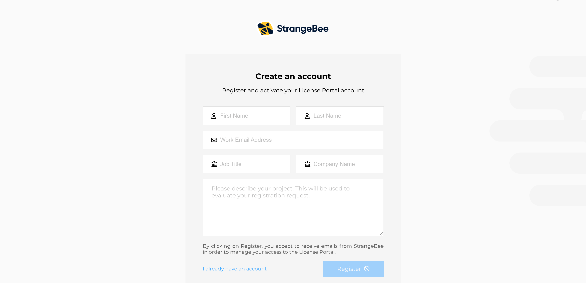
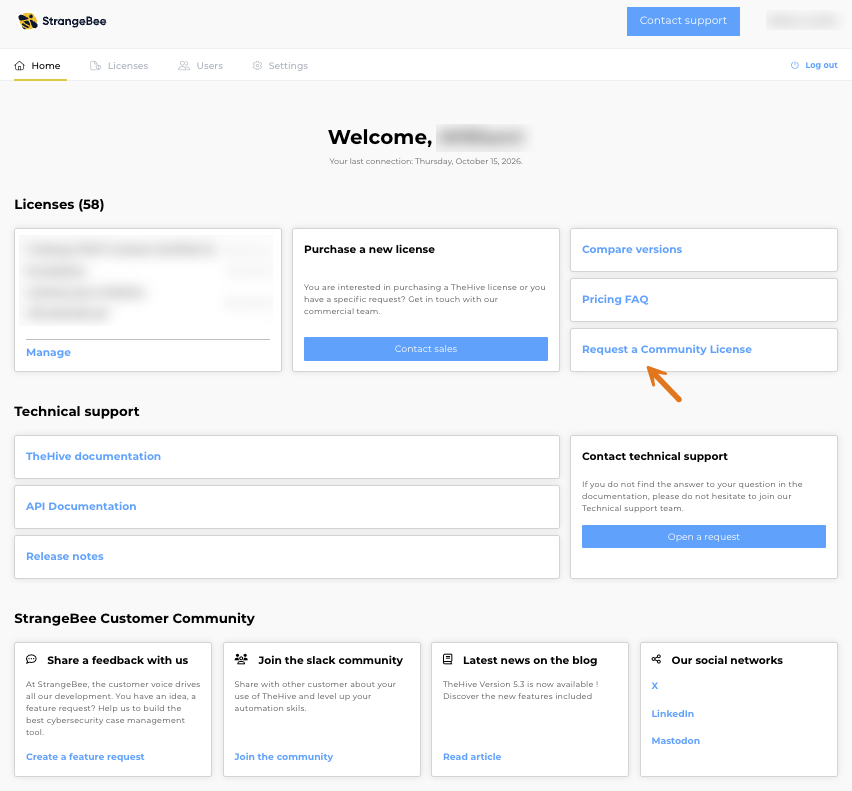
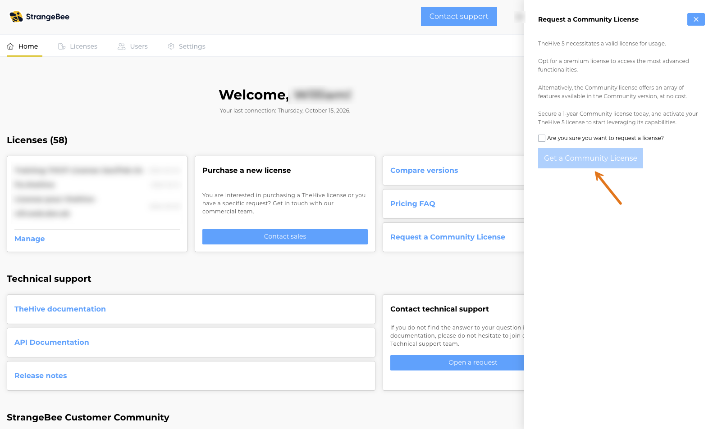

# Request a License for TheHive Community Edition

Request a free license for [TheHive Community Edition](about-licenses.md) to use TheHive for non-commercial purposes, such as learning, academic research, or a personal home lab. TheHive Community Edition includes core incident response features.

!!! info "Non-commercial use only"
    Using TheHive in a professional or commercial environment requires a [Gold, Platinum, or ONE plan](about-licenses.md#plans-and-pricing).

!!! note "TheHive On-prem only"
    TheHive Community Edition is available exclusively for TheHive On-prem deployments and isn't offered for TheHive Cloud Platform.

!!! warning "Upgrading TheHive Community Edition"
    If you’re upgrading to TheHive version 5.3 or later from TheHive 5.x Community Edition, you must complete this procedure to avoid having your interface limited to read-only mode.

<h2>Procedure</h2>

1. Go to the [StrangeBee license portal registration page](https://portal.apps.strangebee.com/account/register){target=_blank}.

    

2. Create an account using a work or academic email address. Free email providers such as Gmail aren't accepted, nor are temporary or forwarding addresses. Keep the project description under 1,000 characters to avoid submission errors.

3. Check your inbox for a confirmation message and verify your email address.

    !!! warning "Account not validated yet"
        At this stage, your account still requires validation by the StrangeBee team.

4. After validation, you receive a notification. Follow the instructions to set your password.

5. Log in to the [StrangeBee license portal](https://portal.apps.strangebee.com/login){target=_blank}.

6. Select **Request a Community license**.

    

7. In the drawer, select **Get a Community license**.

    

<h2>Next steps</h2>

* [Activate or Update a License](license.md)