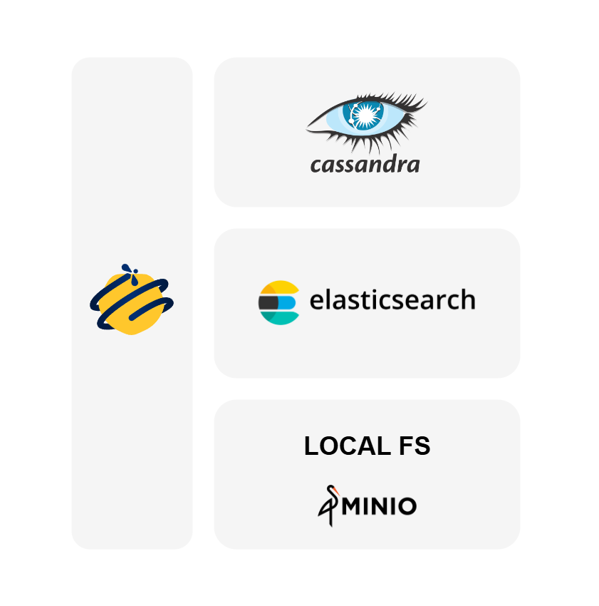
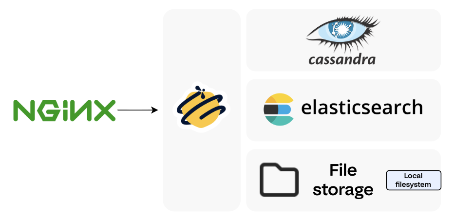
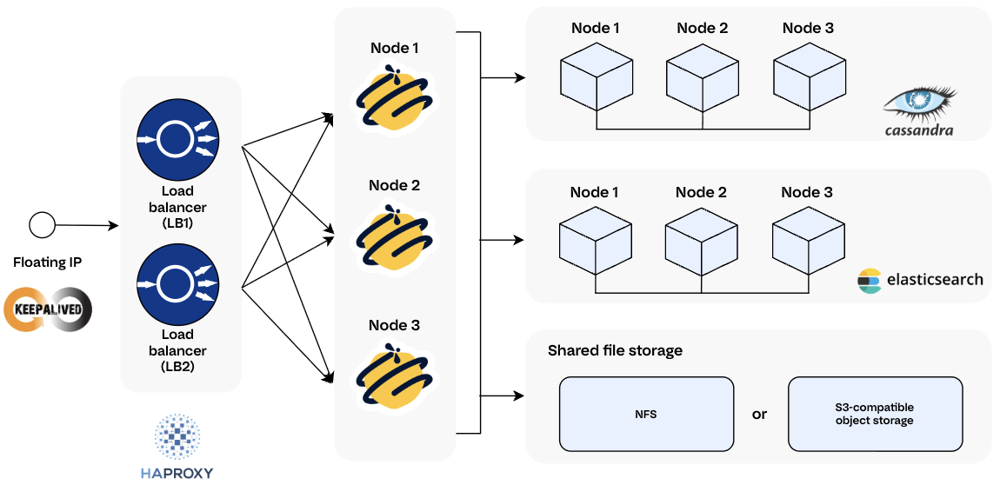

---
hide:
  - toc
---

# TheHive Documentation

## Overview

{ width="300" align=right }

TheHive is a Cybersecurity Incident Response Management (CIRM) platform for Security Operations Center (SOC), Computer Emergency Response Team (CERT), Computer Security Incident Response Team (CSIRT), and Managed Security Service Provider (MSSP) teams. It brings the complete incident lifecycle into a collaborative, case-centric workspace, from the first alert to final resolution.

TheHive works with [Cortex](../../cortex/index.md), the automated analysis and response engine, and with [TheHive Flow](../../flow/user-guides/about-flow.md), its native orchestration and automation layer.

---

## Key features

**Centralized alert management**  
[Alerts](../user-guides/analyst-corner/alerts/about-alerts.md) from every source arrive in one structured queue, deduplicated and ready to triage. [Similar alerts](../user-guides/analyst-corner/cases/find-similar-alerts-cases.md) are correlated, custom views and filters turn alert volume into clear priorities, and a single action escalates an alert to a case.

**Structured case management**  
A [case](../user-guides/analyst-corner/cases/about-cases.md) holds every piece of an investigation: [observables](../user-guides/analyst-corner/cases/observables/about-observables.md), evidence files, [tasks](../user-guides/analyst-corner/tasks/about-tasks.md), decisions, and enrichment results. [Case templates](../user-guides/organization/configure-organization/manage-templates/case-templates/about-case-templates.md) speed up case creation and make sure no investigation step is missed, [custom fields](../administration/custom-fields/about-custom-fields.md) adapt cases to each team's needs, and similar cases can be merged. [Case reports](../user-guides/analyst-corner/cases/case-reports/about-case-reports.md) present key case data in a customizable format, ready to download and share.

**Analysis and response**  
[Cortex analyzers](../administration/cortex/about-cortex.md) enrich observables, and their reports help decide on the right response. Cortex responders, out-of-the-box or custom, trigger response actions directly from a case or an alert.

**Collaboration and visibility**  
Analysts assign tasks, leave comments, and share knowledge. Separate [organizations](../administration/organizations/about-organizations.md) keep teams or clients apart, and [restricted visibility](../user-guides/analyst-corner/cases/case-visibility/restrict-visibility-case.md) limits access to sensitive cases. [Dashboards](../user-guides/analyst-corner/dashboard/about-dashboards.md) follow progress and key metrics, and [SLA rules](../user-guides/sla-management/about-sla-management.md) raise automatic warnings. [TheHive Portal](../administration/thehive-portal/about-thehive-portal.md) shares selected case information securely with external stakeholders.

**Automation with TheHive Flow**  
[TheHive Flow](../../flow/user-guides/about-flow.md) runs workflows straight from a case or an alert, and handles repetitive tasks such as alert triage, enrichment, and escalation. Workflows are built in a visual editor and extended with custom Python or JavaScript code. Every run is recorded step by step, so automation stays transparent and auditable.

**Integrations**  
TheHive connects to [detection, enrichment, and response systems](https://strangebee.com/thehive-integrations/){target=_blank} such as SIEM, EDR, threat intelligence, and ticketing tools, so analysts work from one place. [MISP integration](../administration/misp-integration/about-misp-integration.md) supports threat intelligence sharing, while [notifications](../user-guides/organization/configure-organization/manage-notifications/about-notifications.md) and [functions](../user-guides/organization/configure-organization/manage-functions/about-functions.md) connect external applications directly to TheHive.

---

## Architecture

TheHive can be set up on a standalone server or as a group of servers, known as a cluster, to accommodate different growth requirements. TheHive architecture is highly modular, allowing each layer (TheHive application, database and indexing engine, and file storage) to be deployed independently as standalone nodes or as part of a clustered setup. This flexibility enables complex clustered architectures with virtual IP addresses and load balancers for optimal performance and scalability.

The essential components of TheHive setup include:

- :fontawesome-solid-database: [Apache Cassandra](https://cassandra.apache.org/_/index.html){target=_blank} for robust data storage
- :fontawesome-solid-list: [Elasticsearch](https://www.elastic.co){target=_blank}, serving as a powerful indexing engine
- :fontawesome-solid-folder-tree: A file storage solution, which can be the local filesystem of the server hosting the application for standalone setups, or a shared storage back end such as NFS or an S3-compatible object storage service for clustered environments.

{ width=40% .center }

!!! Danger "Using Lucene"
    Starting from version 5.1, TheHive no longer supports the Lucene back end for indexing. Users who were previously utilizing Lucene with TheHive 4.1.x are advised to migrate their index to Elasticsearch using [this comprehensive guide](../operations/change-index.md).

=== "Standalone server"

    { width=60% .center }

    A standalone server setup involves installing all necessary components on a single server:

    - Apache Cassandra
    - Elasticsearch
    - File storage on the local filesystem
    - TheHive
    - Nginx for HTTPS termination (optional)

    For detailed installation instructions, refer to the [installation guide](../installation/installation-guide-linux-standalone-server.md).

=== "Cluster or hybrid architecture"

    { width=70% .center }

    TheHive and its associated applications offer flexibility in choosing the right setup based on specific requirements. This includes the ability to mix and match different nodes and applications within a cluster.

    Each layer and node within the architecture can be installed on dedicated operating systems, allowing for tailored configurations. The [installation guide for a 3-node cluster](../installation/deploying-a-cluster.md) provides comprehensive instructions for setting up a complex clustered environment.
