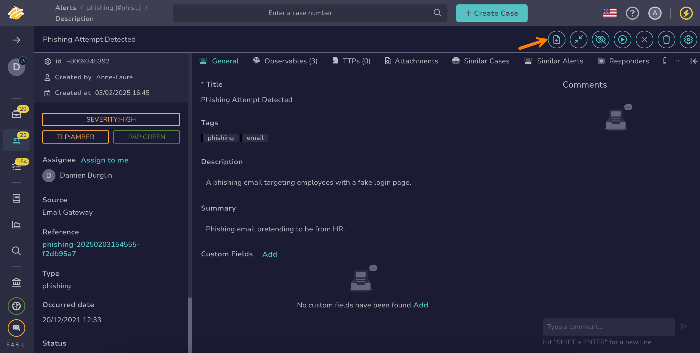

# Create a Case from an Alert

<!-- md:permission `manageAlert/update` -->

Create a [case](../cases/about-cases.md) from an [alert](about-alerts.md) in TheHive during triage when the alert needs further investigation and no case exists yet.

If an investigation is already ongoing, [add the alert to an existing case](add-an-alert-to-an-existing-case.md).

!!! info "Data transfer"
    When creating a case from an alert, data from the alert, including observables, TTPs, attachments, comments, and custom fields, is automatically transferred to the case.

!!! note "Link to case"
    Creating a case from an alert automatically [links the alert to the case](../cases/view-alerts-linked-to-a-case.md).

<h2>Procedure</h2>

!!! tip "Bulk create"
    To create a case from multiple alerts, go to the **Alerts** view and select :fontawesome-regular-square: next to each alert you want to include. Then select :fontawesome-regular-square-plus: above the list. This action merges all the selected alerts into a single case.

    If you select a case template, the **Description** field contains only the template description. Otherwise, the field is empty and you must enter a description. Once the case is created, the description of each alert is added below it, under a `Merged with alert` heading.

    By default, you can merge up to 50 alerts at once. You can change this limit using the `alert.maxMergeInCase` setting in the `application.conf` file. Proceed with caution: modifying this limit may affect platform stability.

1. [Locate the alert you want to merge into a new case](./search-for-alerts/find-an-alert.md).

2. In the alert, select **Create case from alert**.

    

3. In the **Create case** drawer, select either **Empty case** or **From template**.

4. Follow the instructions provided in the related sections:

    * [Create an empty case](../cases/create-a-new-case.md#create-an-empty-case)
    * [Create a case from a template](../cases/create-a-new-case.md#create-a-case-from-a-template)

    !!! info "Case description"
        When you create a case from a single alert, the **Description** field is filled in from the alert and, if you select one, the case template:

        * If both the case template and the alert have a description, the template description comes first, followed by the alert description.
        * If only one of them has a description, the field contains that description.

        You can edit the description before creating the case.

<h2>Next steps</h2>

* [Add Tasks to a Case](../cases/add-tasks-to-a-case.md)
* [Add a Link to a Case](../cases/case-links/add-a-link-to-a-case.md)
* [Change a Case Status](../cases/change-status-case.md)
* [Restrict Case Visibility](../cases/case-visibility/restrict-visibility-case.md)