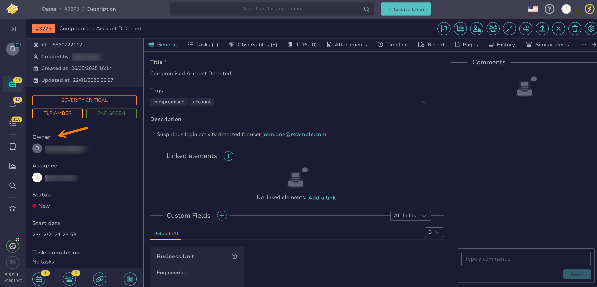

# Change the Owner Organization of a Case

<!-- md:permission `manageCase/changeOwnership` -->

Transfer a [case](about-cases.md) in TheHive to another organization, for example when another team takes over the investigation.

Only the organization that currently owns the case can transfer it, and only to an organization [linked](../../../administration/organizations/link-an-organization.md) to it.

After the transfer:

* The new owner organization gets full access to the case: its users can act on it as far as their own [profile](../../../administration/profiles/about-profiles.md) allows.
* TheHive shares all tasks and observables of the case with the new owner organization. They then follow the task and observable sharing rules of the new owner organization.
* Your organization loses all access to the case, unless you keep access with a profile. That profile sets the maximum permissions your users have on the case, whatever their own profile.
* The [SLA rules](../../sla-management/about-sla-management.md#ownership) of the new owner organization apply to the case and its tasks.

<h2>Procedure</h2>

1. [Find the case](search-for-cases/find-a-case.md) you want to transfer.

2. In the case, move through the **Owner** section in the left pane.

    

3. Select the new owner organization from the dropdown list.

    !!! tip "Can't change the owner?"
        The **Owner** section doesn't appear if your organization isn't linked to any other organization. The dropdown list is unavailable if your organization doesn't own the case or if you don't have the `manageCase/changeOwnership` permission.

4. Optional: Keep access to the case for your organization.

    Keep access if your team still needs to follow the investigation or contribute to it, for example to answer questions from the new owner or to complete tasks already in progress.

    In the **Change case owner** drawer, select **Keep access for my organization**, then select the profile that sets the maximum permissions your users have on the case. For example, select Read-Only to follow the case without changing it, or Analyst to keep working on it.

    !!! warning "Loss of access"
        If you don't keep access, your organization loses all access to the case as soon as you confirm, and TheHive redirects you to the case list.

5. Select **Confirm**.

<h2>Next steps</h2>

* [Share a Case with Other Internal Organizations](share-a-case.md)
* [Organizations Sharing Rules](../../../administration/organizations/about-organizations-sharing-rules.md)
* [About SLA Management](../../sla-management/about-sla-management.md)
