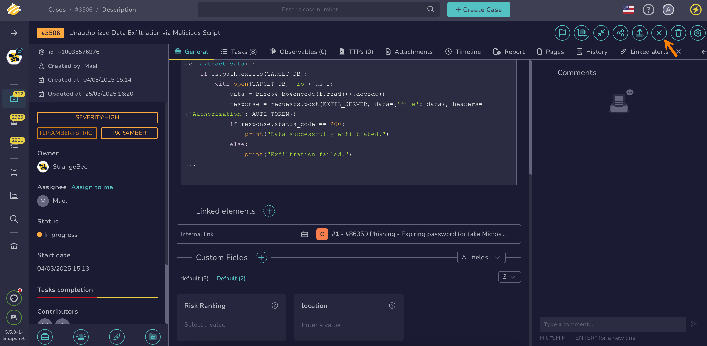

# Close a Case

<!-- md:permission `manageCase/update` -->

Close a [case](about-cases.md) in TheHive when the investigation is complete.

!!! info "Pending tasks"
    Closing a case also permanently closes all pending tasks. This action can't be undone.

<h2>Procedure</h2>

1. [Find the case](../cases/search-for-cases/find-a-case.md) you want to close.

2. In the case, select :fontawesome-solid-xmark:.

    

3. In the **Close case** drawer, select the [status](../../../administration/status/about-statuses.md) that reflects the outcome of the investigation.

4. Optional: If the **Impact** field appears, select **Yes** if the threat affected the organization, for example by compromising a system, exposing data, or disrupting a service. Select **No** if the threat was stopped before causing harm.

    <!-- md:version 6.0 --> The **Impact** field appears for the *True Positive* status and for any other closure status that [requires an impact](../../../administration/status/require-an-impact-for-a-status.md), as configured by an administrator. In earlier versions, it appears only for the *True Positive* status.

    !!! info "Impact field completion"
        When the **Impact** field appears, you must select a value to close the case.

5. Enter a summary describing the outcome of the investigation.

    <!-- md:version 5.5 --> You can add a full-size image by dropping it into the **Summary** field or selecting the :fontawesome-solid-image: symbol.

    !!! warning "Wait for the upload to complete"
        Wait until the image path appears in parentheses. If it doesn’t, the upload is still in progress, and the image won’t display as expected.

6. Add or remove values in [custom fields](../../../administration/custom-fields/about-custom-fields.md) as needed. 

    !!! info "Custom fields completion"
        You must complete all mandatory custom fields to close a case.

7. Select **Close tasks and case**.

<h2>Next steps</h2>

* [Export a Case to MISP](export-a-case-to-misp.md)
* [Export an Archived Case](export-an-archived-case.md)