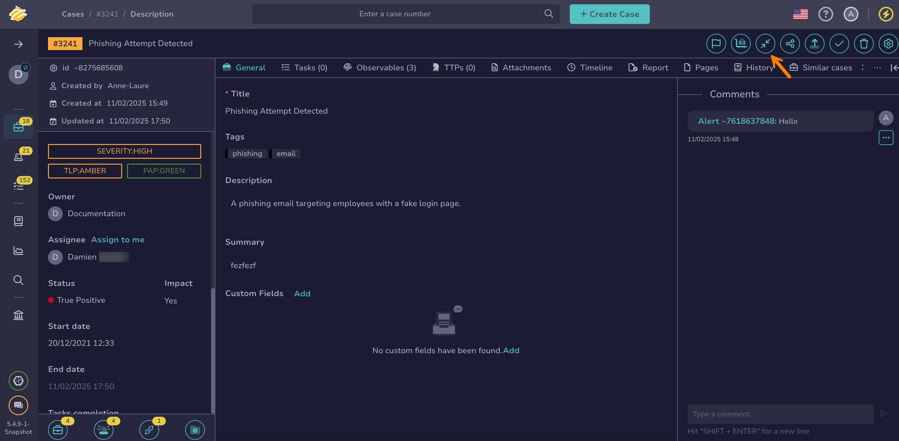

# Merge Cases

<!-- md:permission `manageCase/merge` -->

Merge cases in TheHive to consolidate related investigations into a single case, for example when two cases turn out to cover the same incident.

Merging creates a new case that combines the contents of both cases. TheHive then deletes the two original cases.

You can merge two cases only if:

* Your organization owns both cases, or both cases are shared with it with the Org-Admin [profile](../../../administration/profiles/about-profiles.md)
* Both cases are [shared](share-a-case.md) with the same organizations, with the same profile for each organization
* One case doesn't have [restricted visibility](case-visibility/restrict-visibility-case.md) while the other is [shared with external users](case-thehive-portal/share-case-external-users.md)

After the merge, the new case:

* Gets a new case number
* Combines the title, description, and summary of both cases
* Takes the highest severity, Traffic Light Protocol (TLP), and Permissible Actions Protocol (PAP) of both cases
* Has the *New* status, whatever the status of the original cases
* Is assigned to you
* Keeps the earliest creation date and start date of both cases
* Is flagged if one of the original cases was flagged
* Has the tags, custom field values, tasks, observables, pages, and [links](case-links/view-links-in-a-case.md) of both cases, without duplicates
* Has the alerts, Tactics, Techniques, and Procedures (TTPs), comments, attachments, and [timeline custom events](case-timelines/about-case-timelines.md) of both cases
* Has no case template

The visibility of the new case depends on the access settings of the original cases. See [Merging rules](about-cases.md#merging-rules).

!!! warning "Permanent action"
    You can't undo a merge or restore the original cases.

<h2>Procedure</h2>

1. [Find one of the two cases](../cases/search-for-cases/find-a-case.md) you want to merge.

2. In the case, select the **Merge** button.

    

3. In the **Merge case into case** drawer, search for the case to merge with by its case number or title, then select it.

4. Confirm the merge.

<h2>Next steps</h2>

* [Find a Case](../cases/search-for-cases/find-a-case.md)
* [Create a Case](../cases/create-a-new-case.md)
* [Restrict Case Visibility](./case-visibility/restrict-visibility-case.md)
* [Restore Case Visibility](./case-visibility/restore-visibility-case.md)