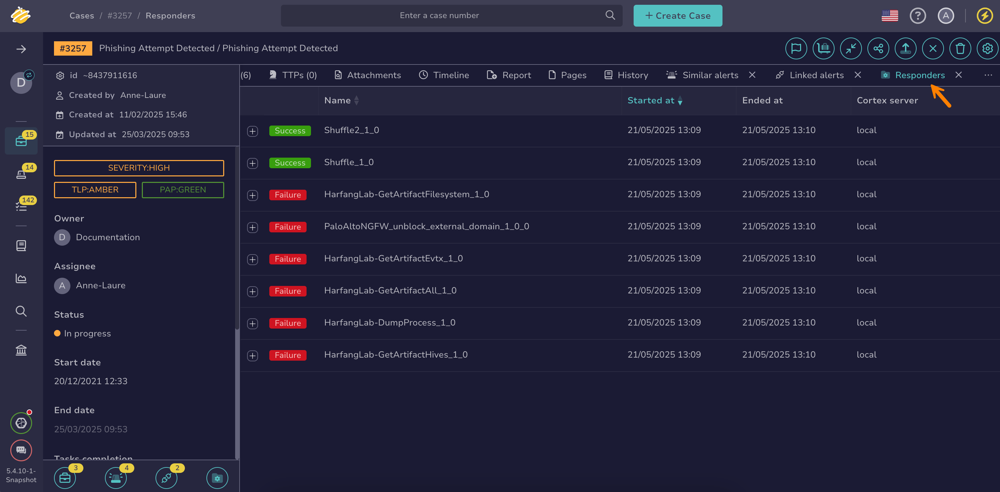

# Run Responders and Review Reports for a Case

[Cortex responders](../../../administration/cortex/about-cortex.md) execute actions on cases, alerts, observables, tasks, and task logs.

Run responders on a [case](about-cases.md) to execute automated actions such as closing an external ticket or performing a predefined response within TheHive.

Only responders authorized for cases and matching their TLP (traffic light protocol) and PAP (permissible actions protocol) levels are available.

!!! note "Observables not included"
    Running a responder on a case doesn't run it on the observables linked to the case. To run responders on an observable, see [Run Responders and Review Reports for an Observable](./observables/run-responders-on-an-observable.md).

!!! tip "Running functions on a case"
    <!-- md:version 5.4 --> Did you know it’s possible to run functions on cases just like running responders? See [Run a Function on a Case or an Alert](../../organization/configure-organization/manage-functions/run-a-function-case-alert.md) for detailed instructions.

## Run responders on a case

1. [Locate the case](./search-for-cases/find-a-case.md) on which you want to run responders.

2. In the case, select **Responders**.

    

    <!-- md:version 6.0 --> You can also run responders from the Automation Center: go to the **Automations** tab, select the **Responders** tab, then select **Run Responders**.

3. In the drawer, select the responders you want to run.

4. Select **Launch actions**.

5. Select **Confirm**.

## Review responder reports for a case

1. [Locate the case](./search-for-cases/find-a-case.md) on which you ran responders.

2. In the case, select the **Responders** tab to check the status of the executed responders.

    

    <!-- md:version 6.0 --> You can also check them in the Automation Center: go to the **Automations** tab and select the **Responders** tab. This list also includes the responders run on the observables, tasks, and task logs of the case, with the following columns:

    * Status: Whether the responder is waiting, in progress, succeeded, failed, or was deleted from Cortex
    * Name: The responder that ran. The name is blank while the responder is waiting.
    * Title: The observable, task, or task log the responder ran on. Select it to open the observable or task. A dash means the responder ran on the case itself.
    * Entity: The type of object the responder ran on
    * Triggered by: Who ran the responder
    * Start date: When the responder started

<h2>Next steps</h2>

* [Add Tasks to a Case](add-tasks-to-a-case.md)
* [Change a Case Status](change-status-case.md)
* [View Alerts Linked to a Case](view-alerts-linked-to-a-case.md)
* [Find Similar Alerts or Cases](find-similar-alerts-cases.md)
* [Merge Cases](merge-cases.md)
* [Close a Case](close-a-case.md)
