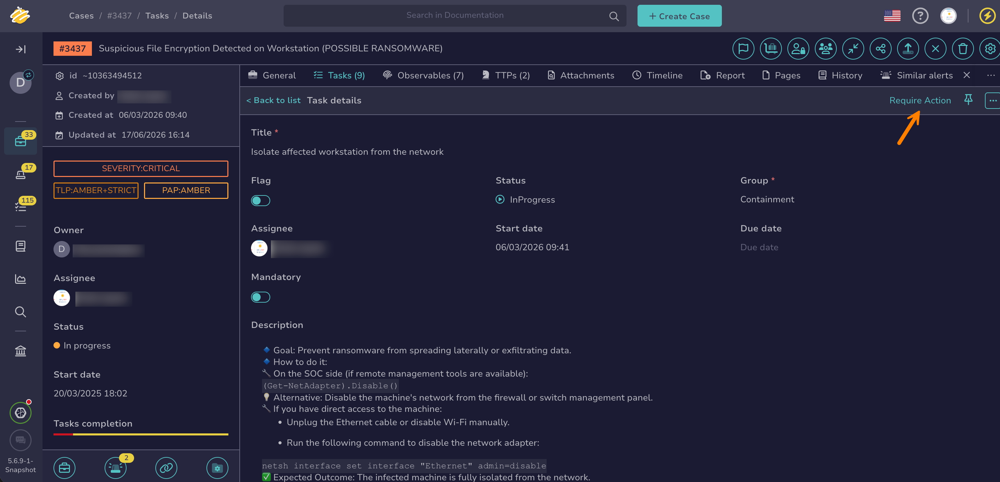
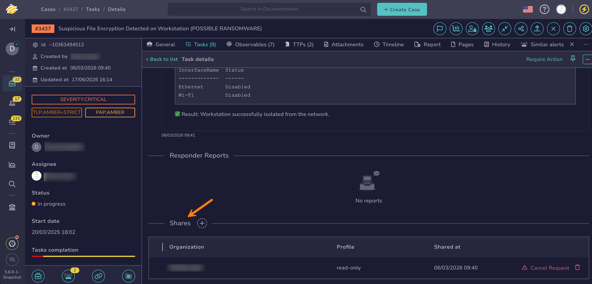
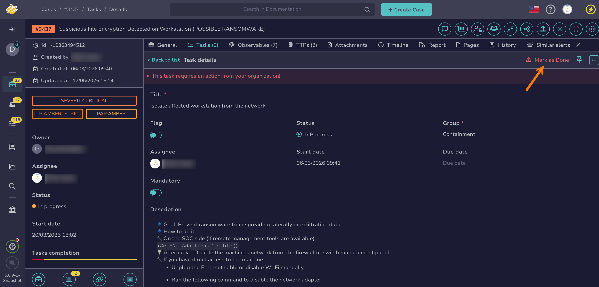
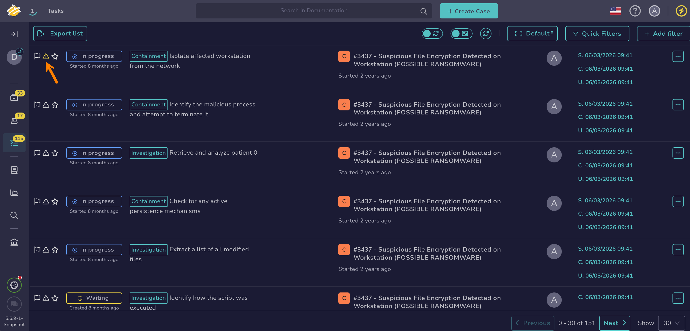
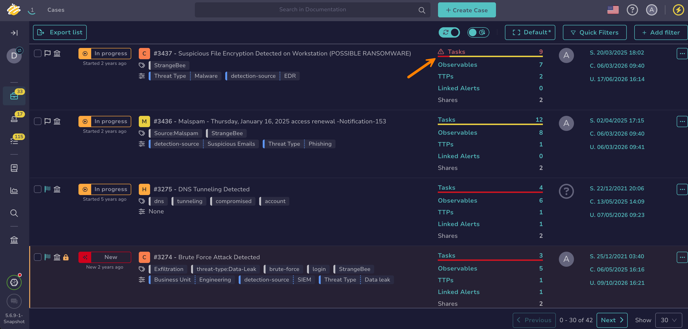

# Manage Required Actions on a Task

Ask your own organization or a [linked organization](../../../administration/organizations/link-an-organization.md) to take action on a [task](about-tasks.md). Use this when you need input or assistance from your team or from another team to move an investigation forward.

Requiring action doesn't change the [task status](change-task-status.md), so work on the task can continue while you wait. The organization you ask sees the request on the task and [marks the action as done](#mark-a-required-action-as-done) once it has acted.

## Require action from your organization

<!-- md:permission `manageTask` -->

1. [Find the task](search-for-tasks/find-a-task.md) you want to require action on.

2. At the top of the task details, select **Require Action**.

    

3. Choose whether to add a task log to explain your request:

    * To add a task log, select **Create a log**.
    * To send the request without a task log, select **Proceed without log**.

## Require action from a linked organization

<!-- md:permission `manageShare` -->

!!! info "Shared tasks only"
    You can require action only from linked organizations the task is shared with. If the task isn't shared yet, refer to [Share a Task with Other Internal Organizations](share-a-task.md).

1. [Find the task](search-for-tasks/find-a-task.md) you want to require action on.

2. Move through the **Shares** section.

    

3. In the row of the organization you want to ask, select **Require Action**.

4. Choose whether to add a task log to explain your request:

    * To add a task log, select **Create a log**.
    * To send the request without a task log, select **Proceed without log**.

## Cancel an action request to a linked organization

<!-- md:permission `manageShare` -->

1. [Find the task](search-for-tasks/find-a-task.md) where you required action.

2. Move through the **Shares** section.

    

3. In the row of the organization, select **Cancel Request**.

4. Choose whether to add a task log:

    * To add a task log, select **Create a log**.
    * To cancel without a task log, select **Proceed without log**.

## Mark a required action as done

<!-- md:permission `manageTask` -->

When action is required from your organization, the task details display the message *This task requires an action from your organization!* The request can come from a linked organization or from a member of your own organization.

1. [Find the task](search-for-tasks/find-a-task.md) that requires action.

2. At the top of the task details, select **Mark as Done**.

    

3. Choose whether to add a task log:

    * Recommended: To record what you did, select **Create a log**.
    * To mark the action as done without a task log, select **Proceed without log**.

## Visual indicators for required actions

TheHive highlights tasks and cases that require action from your organization:

* 

    

* 

    

<h2>Next steps</h2>

* [Share a Task with Other Internal Organizations](share-a-task.md)
* [Create a Task Log](create-a-task-log.md)
* [Change a Task Status](change-task-status.md)
* [Manage Tasks](manage-a-task.md)
* [Organizations Sharing Rules](../../../administration/organizations/about-organizations-sharing-rules.md)
