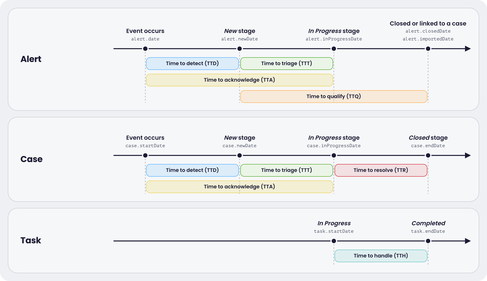

# Key Performance Indicators

<!-- md:version 5.1 -->

TheHive provides valuable insights into event and incident time metrics, enabling you to track key performance indicators (KPIs) for [cases](../analyst-corner/cases/about-cases.md), [alerts](../analyst-corner/alerts/about-alerts.md), and <!-- md:version 5.7 --> [tasks](../analyst-corner/tasks/about-tasks.md).

By default, case and alert KPIs appear in the **Time metrics** section of the left pane in case and alert descriptions, and the task KPI appears as the **Handling time** indicator in the task details. However, you can [hide some or all indicators for cases and alerts](../organization/configure-organization/manage-ui-configuration/hide-key-performance-indicators.md) if they're not useful or may be misleading for your organization.

In case and alert descriptions, a KPI appears only when its value is greater than 0.

You can also include these KPIs in dashboards. Case reports can include case and alert KPIs, but not task KPIs.



## KPI lifecycle

The following diagram shows the dates each KPI measures for alerts, cases, and tasks.

!!! note "Cases linked to alerts"
    When you [create a case from an alert](../analyst-corner/alerts/create-a-case-from-an-alert.md) or [add an alert to an existing case](../analyst-corner/alerts/add-an-alert-to-an-existing-case.md), the time to detect (TTD), time to triage (TTT), time to acknowledge (TTA), and time to qualify (TTQ) of the case are computed from the alert dates rather than the case dates. The dates come from the first alerts linked to the case. If several alerts are linked at the same time, the earliest dates are used.

!!! tip "Calculation rules"

    For the definition of each date field, see [Date Field Definitions for Alerts and Cases](../date-field-definitions-alerts-cases.md).

    * `alert.date` corresponds to the **Occurred date** field of the alert. It's the date of the original event, as sent by the source that created the alert.
    * `newDate`, `inProgressDate`, `closedDate`, and `importedDate` record the first time the case or alert entered a status linked to the corresponding [stage](../../administration/status/about-statuses.md#attributes). Later status changes don't update them. For the *New*, *In Progress*, and *Closed* stages, custom statuses count too.
    * If a case or alert is closed without reaching the *In Progress* stage, its closure date is also used as its *In Progress* date.
    * A KPI with a negative result isn't recorded. Time to detect (TTD) is set to 0 instead.

## Time to detect (TTD)

The time it takes to set the status of a case or alert to one linked to the *New* stage in TheHive after the event occurs. This metric helps assess the effectiveness of your monitoring tools and detection capabilities.

| KPI | Formula | In case description | In alert description |
|-----------|------------------|-------------------|--------------------|
| Time to detect (TTD) | = date of status *New* - event date | = `case.newDate` - `case.startDate` | = `alert.newDate` - `alert.date` |

## Time to triage (TTT)

The time it takes for your Security team to acknowledge a case or alert by changing its status to one linked to the *In Progress* stage in TheHive. It reflects how efficiently alerts and cases are reviewed and escalated for investigation.

| KPI | Formula | In case description | In alert description |
|-----------|------------------|-------------------|--------------------|
| Time to triage (TTT) | = date of status *In Progress* - date of status *New* | = `case.inProgressDate` - `case.newDate` | = `alert.inProgressDate` - `alert.newDate` |

If the alert linked to a case never reached the *In Progress* stage, the date the alert was linked to the case is used as `alert.inProgressDate`.

The alert description displays TTT only when the alert isn't at the *New* stage.

## Time to acknowledge (TTA)

The time it takes for your Security team to acknowledge a case or alert by changing its status to one linked to the *In Progress* stage after the event occurs. This measures the responsiveness of your team after detecting a potential security incident.

| KPI | Formula | In case description | In alert description |
|-----------|------------------|-------------------|--------------------|
| Time to acknowledge (TTA) | = date of status *In Progress* - event date | = `case.inProgressDate` - `case.startDate` | = `alert.inProgressDate` - `alert.date` |

TTA includes TTD. A high TTA can come from an alert that reached TheHive late rather than from a slow response. To measure the time between the creation of a case or alert in TheHive and its acknowledgement, use the [TTT](#time-to-triage-ttt).

If the alert linked to a case never reached the *In Progress* stage, the date the alert was linked to the case is used as `alert.inProgressDate`.

The alert description displays TTA only when the alert isn't at the *New* stage.

## Time to qualify (TTQ)

The time it takes for your Security team to analyze an alert and determine whether it is a true positive or false positive, resulting in the alert being closed or linked to a case. This metric helps measure the accuracy and speed of the qualification process.

| KPI | Formula | In case description | In alert description |
|-----------|------------------|-------------------|--------------------|
| Time to qualify (TTQ) | = date of alert closure or merge into case - date of status *New* | = `alert.importedDate` - `alert.newDate`, only if the case is linked to an alert | = `max(alert.importedDate, alert.closedDate)` - `alert.newDate` |

The case description displays TTQ only when the case isn't at the *New* stage. The alert description doesn't display TTQ. It's available for alerts in the [API](https://docs.strangebee.com/thehive/api-docs/#tag/Alert/operation/Get%20Alert), dashboards, and case reports.

## Time to resolve (TTR)

The time it takes for your Security team to fully resolve an incident after its status is set to one linked to the *In Progress* stage. This includes investigation, remediation, and closure, indicating the efficiency of your incident response process.

| KPI | Formula | In case description | In alert description |
|-----------|------------------|-------------------|--------------------|
| Time to resolve (TTR) | = end of the incident date - date of status *In Progress* | = `case.endDate` - `min(alert.inProgressDate, case.inProgressDate)` | not applicable |

The case description displays TTR only when the case is at the *Closed* stage.

!!! note "Handling duration fields"
    TheHive provides two handling duration fields. They predate the KPIs and use different formulas:

    * `handlingDuration` is available for cases only. It's stored with the case and equals `case.closedDate` - `min(alert.inProgressDate, case.inProgressDate)`, where `alert.inProgressDate` is the earliest in-progress date among the alerts of the first import into the case, or the import time if none of them has one. It's calculated when the case is closed. If the case had no alerts at that point, importing its first alert can change the value. Later imports don't.
    * `computed.handlingDuration` is calculated each time it's requested. For cases, it equals `case.endDate` - `case._createdAt`. For alerts, it equals `alert.importedDate` - `alert._createdAt`. It's 0 when the case has no end date or the alert isn't linked to a case.

    Use the [Time to resolve metric](#time-to-resolve-ttr) instead.

## Time to handle tasks (TTH) {#time-to-handle-tasks}

<!-- md:version 5.7 -->

The time it takes for your Security team to complete a task, from the moment work begins to when the task is marked as completed. This metric helps identify bottlenecks and measure team efficiency at the task level.

It's only available when a task has the status *Completed*.

| KPI | Formula |
|-----------|------------------|
| Time to handle (TTH) | = `task.endDate` - `task.startDate` |

When a task is set to *Completed*, a missing or future start date and a missing end date are replaced by the completion date. A task completed without being started has a time to handle of 0.

<h2>Next steps</h2>

* [Date Field Definitions for Alerts and Cases](../date-field-definitions-alerts-cases.md)
* [Hide Key Performance Indicators](../organization/configure-organization/manage-ui-configuration/hide-key-performance-indicators.md)
* [Measure Case Performance](measure-case-management-performance.md)
* [Measure Alert Performance](measure-alert-management-performance.md)
* [Measure Task Performance](measure-task-management-performance.md)