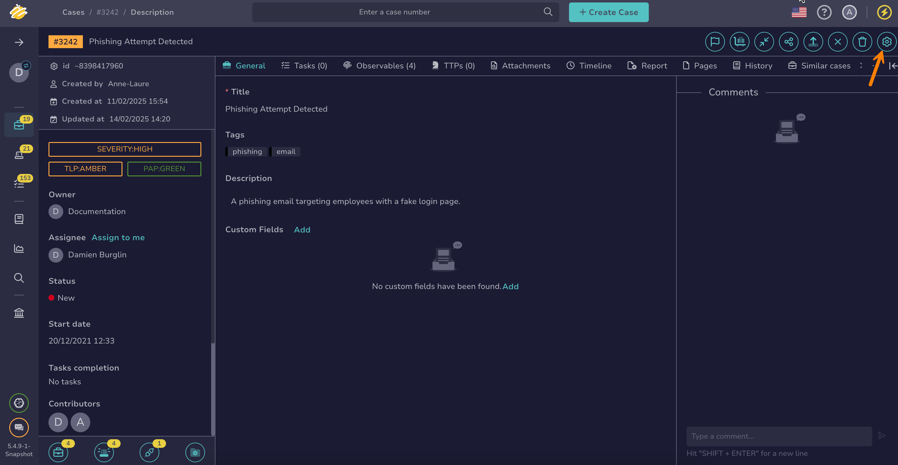

# Manually Run a Function on a Case or an Alert and Review Results

<!-- md:version 5.4 --> <!-- md:permission `manageFunction/invoke` --> <!-- md:license Platinum --> <!-- md:license One -->

Manually run a [function](about-functions.md) on a [case](../../../analyst-corner/cases/about-cases.md) or an [alert](../../../analyst-corner/alerts/about-alerts.md) in TheHive.

Only functions with the [**Action: Case** or **Action: Alert** type](about-functions.md#function-types) matching the object are available.

## Run a function on a case or an alert

<!-- md:permission `manageAction` --> <!-- md:permission `manageAlert/update` -->

1. [Locate the case](../../../analyst-corner/cases/search-for-cases/find-a-case.md) or [alert](../../../analyst-corner/alerts/search-for-alerts/find-an-alert.md) on which you want to run the function.

2. In the case or alert, select :fontawesome-solid-gear:.

    

3. In the drawer, select the **Functions** tab.

    <!-- md:version 6.0 --> You can also run functions from the Automation Center: go to the **Automations** tab of the case or alert, select the **Functions** tab, then select **Run Functions**.

4. Select one or more functions to run.

5. Select **Launch actions**.

## Review function execution results

1. Open the case or alert on which you ran functions.

2. Go to the **Automations** tab.

3. Select the **Functions** tab to check the status of the executed functions.

    The tab lists the functions run on the case or alert, including the ones run by a [notification](../manage-notifications/notifiers/function.md). Dry-run executions aren't listed.

    The list has the following columns:

    * Status: Whether the function succeeded or failed
    * Name: The function that ran
    * Triggered by: Who ran the function. Functions run by a notification show the TheHive system user.
    * Start date: When the function started

<h2>Next steps</h2>

* [Invoke a Function](invoke-a-function.md)
* [Delete a Function](delete-a-function.md)